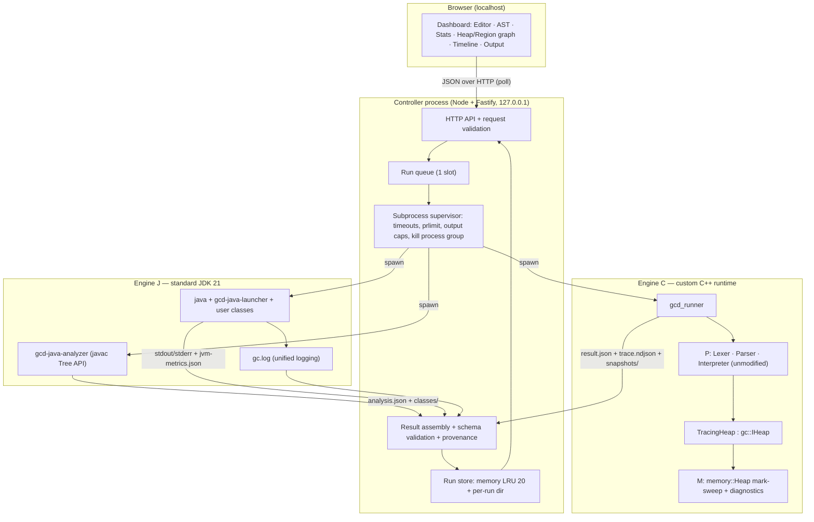
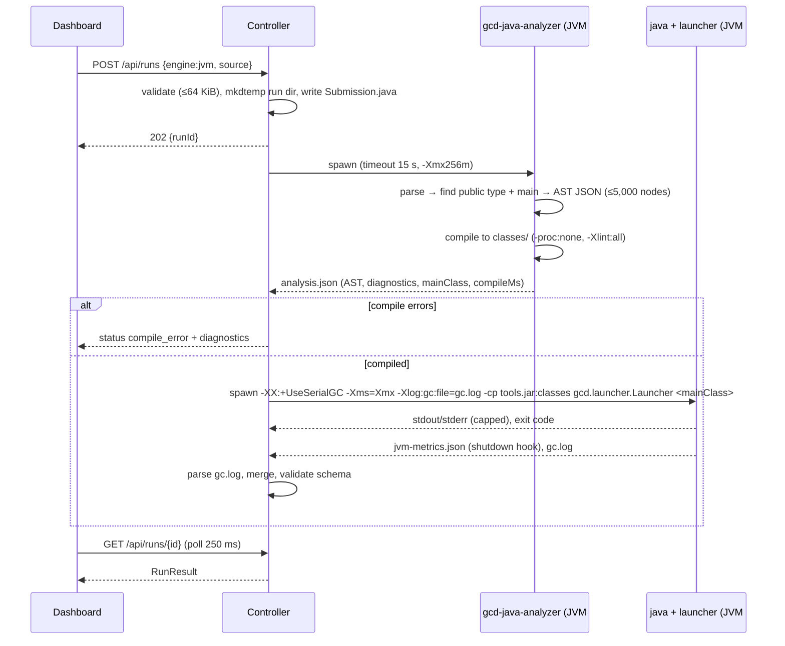
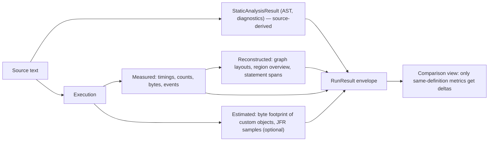
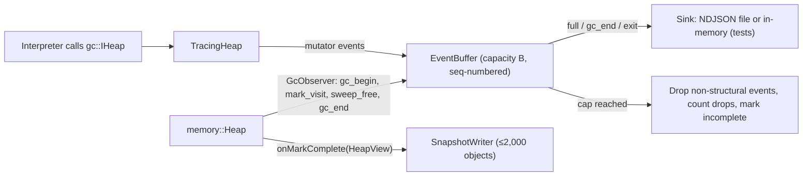
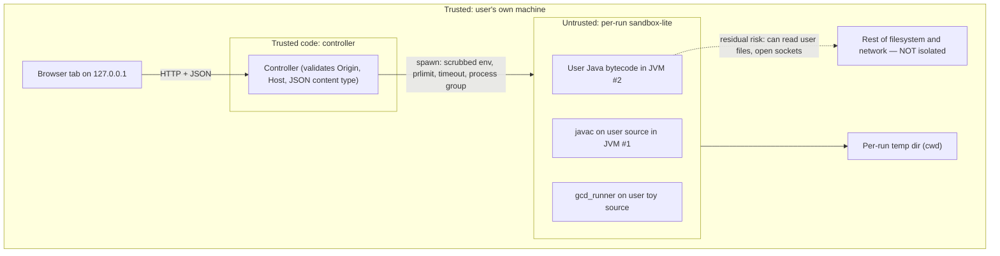
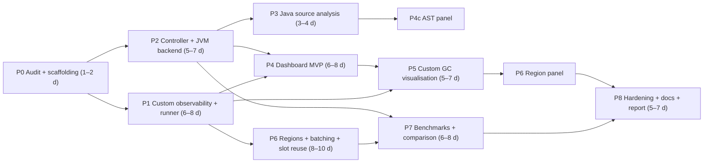

# garbage-cd V2 — Architecture, Research & Implementation Plan

Oct 17, 2026 · @Brij Mohan Mishra

## How to read this plan

Every architectural decision in this plan is final; per the brief's instruction to run without a human in the loop, the former "open questions" are resolved in Document L and because V2 has a single owner, nothing waits on anyone else's sign-off. The repository was cloned at commit `7f46d69` (16 Sep 2026), built with GCC 13.3 / CMake 4.4, tested, run under ASan+UBSan, and probed with throwaway harnesses outside the repo; no repository file was modified.

Each statement carries one of these tags so the categories never blur:

| Tag | Meaning | Who may change it |
| --- | --- | --- |
| **\[V\]** Verified | Observed in the repo or reproduced by running code during this audit | Nobody: it is a fact; re-verify if the repo moves |
| **\[E\]** Established | Fixed by the brief (two engines, no JVM modification, ownership split) | Only the project owners |
| **\[D\]** Decided | Chosen by this plan after analysis; binding on GPT | Only by a revised plan |
| **\[G\]** GPT discretion | Local implementation detail GPT may choose while coding | GPT, within the stated invariants |
| **\[C\]** Frozen | Frozen by design: the V1 interpreter/runtime files and gc\_interface.hpp stay unchanged so the V1 baseline stays reproducible and the interface boundary stays clean | Only by a revised plan |

Naming used throughout: **M** = you, the sole owner and designer of V2 (the README still credits Akshat Raj for the V1 collector, commits `d2dde87`/`f862181`). Labels such as "P", "P-owned" or "P's code" refer to the V1 interpreter and runtime written by Prateek Sagar; in V2 those files are frozen by design, not by ownership, and nobody else reviews or approves anything. **Engine J** = standard JVM, **Engine C** = custom C++ runtime.

## Document A — Executive summary

V2 is a local, single-user web console that runs real Java on a stock JDK 21 and toy-language programs on the existing C++ mark-sweep runtime, side by side but never pretending they share a heap. It is built as one Node/TypeScript controller that launches three small command-line tools as subprocesses; no Docker, database, queue or cloud service is needed.

**What exists today \[V\].** The repo is about 1,150 lines of C++17. Lexer, parser, interpreter and mark-sweep are all implemented and correct on every case probed, despite the README still saying "skeleton only". The language is straight-line: no loops, branches, functions or arithmetic. The collector never reuses heap slots, so a collection with one live object costs 3 ms after 1 M allocations and about 20 ms after 6 M; cost tracks *every allocation ever made*, not the live heap. Every lexer, parser or runtime error aborts the process (exit 134) because `main` catches nothing.

**Architecture \[D\].**

- **Engine J** — `gcd-java-analyzer` (Compiler Tree API: AST + diagnostics + compile, one JVM) then `java` with a tiny `gcd-java-launcher` wrapper (MXBean totals) and HotSpot unified GC logging (`-Xlog:gc`). Default collector: Serial GC, whose old generation is mark-sweep-compact and is therefore the closest production analogue.
- **Engine C** — a new `gcd_runner` executable that reuses P's `Lexer`, `Parser` and `Interpreter` unmodified, wraps `memory::Heap` in a `TracingHeap` decorator behind `gc::IHeap`, and steps the program one statement at a time. `gc_interface.hpp` is **not** changed.
- **Controller** — Node 22 + TypeScript + Fastify, bound to `127.0.0.1`, one run at a time, per-run temp directory, hard timeouts, output caps and Linux `prlimit` limits.
- **Dashboard** — React + TypeScript + Vite, CodeMirror 6 editor, `react-resizable-panels` layout, Cytoscape.js for heap and region graphs.

**The refinement, reframed \[D\].** The brief's "forest of regions" is split into three separately measured pieces, none of which may change what the collector frees in V2:

1. **Region metadata** — a region is a fixed block of 64 consecutive heap slots (G1/Immix-style address regions). A write barrier in `setField` maintains exact cross-region reference counts, so a bounded region overview costs O(regions + region edges) instead of O(objects + references). The region graph is a directed graph with cycles, not a forest.
2. **The forest that is real** — the mark phase's first-discovery edges form a spanning forest rooted at the GC roots. Recording it gives a "why is this object alive?" retention path for free.
3. **Batched instrumentation** — a bounded, sequence-numbered event buffer flushed as NDJSON batches, compared against per-event writes.

A fourth, small variant — **slot reuse with generation-checked handles** — fixes the measured scan-cost defect. It encodes the generation inside the existing `size_t` handle value, so the shared interface is untouched.

**Novelty claim \[D\].** None of these techniques is new: address regions (G1, Immix), remembered sets (generational GC), connectivity partitions (Hirzel et al. 2003) and buffered tracing (JFR, LTTng) are all published. The contribution is an engineering integration plus a controlled empirical evaluation (hypotheses H1–H5) on an instrumentable collector, presented next to a production JVM with explicit provenance on every number. Using region summaries to skip tracing (H6) is deferred.

**Deliverables.** (A) the console; (B) the collector experiment: variants A, A′, B, C, D, E with a differential-correctness suite and a reproducible benchmark harness; (C) the academic report. The first end-to-end result — paste a toy program, click Run, see output and per-GC statistics as JSON — arrives in Phase 1, before any web code exists.

**Biggest risks.** Scope creep in the dashboard; Java-execution safety being over-claimed; and the toy language having no loops, which forces collector benchmarks to drive `gc::IHeap` directly rather than through scripts.

## Document B — Verified repository audit

The repository builds warning-free under `-Wall -Wextra -Wpedantic`, passes both tests (also under ASan+UBSan), and correctly collects reachable chains, shared references and cycles; its main weaknesses are unbounded slot growth, abort-on-error, and tests that silently stop checking in Release builds. Everything in this section is **\[V\]** unless tagged otherwise.

### B.1 Snapshot and environment

| Item | Value |
| --- | --- |
| Commit audited | `7f46d69` (merge of PR #5, 16 Sep 2026); 7 commits total |
| Authors | Prateek Sagar (scaffold, merges), Akshat Raj (mark `d2dde87`, sweep `f862181`) |
| Size | 24 tracked files, 1,155 lines including README and CMake |
| Language / build | C++17, `CMAKE_CXX_EXTENSIONS OFF`, CMake ≥ 3.15, single flat `CMakeLists.txt` |
| External dependencies | None (standard library only; README states this is intentional) |
| Audit toolchain | GCC 13.3.0, CMake 4.4.4, OpenJDK 21.0.12 (javac), Node 22.22, Ubuntu 24.04, 1 vCPU, 3 GiB RAM |

### B.2 Repository structure and ownership

| Path | Purpose | Lines | Owner (README) |
| --- | --- | --- | --- |
| `include/gc_interface.hpp` | `gc::ObjectHandle`, `gc::GCStats`, `gc::IHeap` | 73 | Shared — change only by agreement |
| `include/memory/object.hpp`, `src/memory/object.cpp` | `memory::Object`: `unordered_map<string, ObjectHandle>` fields + `bool marked` | 29 + 17 | M |
| `include/memory/heap.hpp`, `src/memory/heap.cpp` | `memory::Heap : gc::IHeap` — slots, roots, stats, `resolve()` | 48 + 57 | M |
| `src/memory/mark.cpp` | `Heap::mark()` — explicit-worklist DFS from roots | 54 | M |
| `src/memory/sweep.cpp` | `Heap::sweep()` — linear slot scan, frees unmarked | 28 | M |
| `include/interpreter/{ast,lexer,parser,interpreter}.hpp` + `src/interpreter/*.cpp` | Tokenizer, recursive parser, tree-walking interpreter | 146 + 322 | P |
| `include/runtime/{value,environment}.hpp` + `src/runtime/*.cpp` | `Value` (null/int/handle), flat `Environment` | 57 + 44 | P |
| `src/main.cpp` | Reads a script path (default `examples/sample_program.txt`), runs it | 37 | P |
| `tests/gc_tests.cpp` | 1 smoke test for the heap | 35 | M |
| `tests/interpreter_tests.cpp` | 3 smoke tests: value/env, lexer+parser, end-to-end | 93 | P |
| `CMakeLists.txt`, `README.md`, `.gitignore`, `examples/` | Build, docs, sample | — | Unassigned in V1; M in V2 |

### B.3 Shared interface (`gc_interface.hpp`)

- `ObjectHandle` wraps one `std::size_t`; invalid = `SIZE_MAX`. Its constructor from `size_t` and `raw()` are public, so any code can mint a handle; the comment says `raw()` is for the heap only.
- `GCStats` has four counters: `totalAllocations`, `totalCollections`, `objectsCollectedLastRun`, `liveObjectsAfterLastRun`. No timings, bytes, mark counts or edge counts.
- `IHeap` has seven virtuals: `allocate`, `setRoot(name, h)`, `clearRoot(name)`, `setField(obj, field, target)`, `getField(obj, field)`, `collect`, `getStats`. Roots are keyed by **variable name**, not by handle.
- The interpreter includes only this header plus its own; `memory/*` is never included by interpreter code. The boundary holds in the actual code, not just the README.

### B.4 Language and front end

The language is six statement forms over a flat global scope: `x = new Object();`, `x = <int>;`, `x = null;`, `x = y;`, `x = y.f;`, `x.f = <obj|null>;`, plus `gc();`. There are no loops, conditionals, functions, operators, strings or comments; `print` does not exist, so the only program output is the `gc()` report.

- **Lexer** — one pass, keywords `new Object null gc`; `std::stoi` on integer literals. Tokens carry **no line/column**.
- **Parser** — hand-written; one `Program{vector<Stmt>}`; expressions are single primaries. AST nodes carry **no source positions**.
- **Consequence** — every statement ends in exactly one `;`, and `;` cannot appear anywhere else, so statement *i*'s source span can be derived exactly by counting semicolons without touching P's code (used in D.4).

### B.5 Runtime flow and root model

`main` → `Lexer::tokenize` → `Parser::parseProgram` → `memory::Heap heap` → `Interpreter(heap).run(program)`.

- On `x = expr`, the interpreter evaluates the right side, stores it in `Environment`, calls `clearRoot(x)`, and re-registers `setRoot(x, h)` only if the value is an object. Every object-valued variable is therefore exactly one root; int and null variables are not roots.
- `gc()` calls `collect()` then prints the four `GCStats` counters to `std::cout`.
- `Interpreter::run` iterates `program.statements`; the `Environment` is a member and persists across `run` calls. A host can therefore execute a program one statement at a time by calling `run` with single-statement `Program`s. **The V2 runner relies on this.**
- Each process runs one program with one fresh `Heap`; there is no reset API. Multiple programs per process are possible only by constructing new `Heap`/`Interpreter` objects.

### B.6 Collector implementation

- **Allocation** — `objects_.push_back(make_unique<Object>())`; handle = slot index. Slots are **never reused**: `objects_` and `slotInUse_` grow by one per allocation forever.
- **Mark** — clears `marked` on every in-use slot, seeds a vector worklist from all roots, pops, skips null/stale/already-marked, marks, pushes every valid field target. Correct on cycles because of the marked check; worst-case worklist size is the number of edges, not objects.
- **Sweep** — scans every slot ever allocated; frees unmarked objects (`reset()`, `slotInUse_ = false`), clears marks on survivors, writes `objectsCollectedLastRun` and `liveObjectsAfterLastRun`.
- **Stale handles** — because slots are never reused, a freed handle resolves to `nullptr` forever; `getField` returns invalid and `setField` is a no-op. Verified with a harness. Generation checks are **not** needed today; they become necessary only if slot reuse is introduced.
- **Field storage** — each object holds an `unordered_map<string, ObjectHandle>`; field names are heap-allocated strings per object.

### B.7 Behaviour observed by running code

| Probe | Result |
| --- | --- |
| Sample program | 2 collected, 0 live, 2 allocations, 1 collection; exit 0 |
| Self-cycle + chain + partial unroot | 1 collected, 2 live — correct |
| Two-object unreachable cycle | 2 collected — correct |
| `a = 5; a.f = null;` | uncaught `runtime_error` ("Interpreter: …"), **exit 134** |
| `a = ;` | uncaught `runtime_error` ("Parser: …"), **exit 134** |
| `// comment` | uncaught `runtime_error` ("Lexer: unexpected character '/'"), **exit 134** |
| `a = 99999999999999999999;` | uncaught `std::out_of_range` from `stoi`, **exit 134** |
| Empty file | no output, exit 0 |
| Run from `build/` with no argument | "Could not open script", exit 1 (default path is relative to the repo root) |
| ASan + UBSan, both tests + sample | clean |
| `collect()` with 1 live object after 1 M / 3 M / 6 M total allocations | **3.1 / 9.8 / 20.1 ms** — linear in allocations ever made |

### B.8 Tests

- `gc_tests` checks handle validity, `getField` round-trip, and that `totalCollections` increments. It never checks that anything is reclaimed or survives; its comment still says mark/sweep are no-ops.
- `interpreter_tests` checks values, environment, a 3-statement parse, and allocation/collection counts end to end.
- Both use `assert`. In a `Release` build CMake adds `-DNDEBUG`, so **both tests pass while checking nothing**.
- There is no correctness coverage for: chains, multiple roots, shared references, cycles, root replacement, repeated collections, stale handles, or error paths.

### B.9 Defect and gap register

| ID | Severity | Defect | Owner | Plan response |
| --- | --- | --- | --- | --- |
| D1 | High | Slot table never shrinks or reuses; mark-reset and sweep are O(all allocations ever) | M | Variant E (Phase 6C), measured against baseline |
| D2 | High | Every front-end/runtime error aborts with exit 134; no structured error | P (`main.cpp`) | Runner catches and classifies; `main.cpp` left untouched |
| D3 | High | Tests are no-ops under `NDEBUG` | M + P | `-UNDEBUG` on test targets from `cmake/gcd_v2.cmake`; new tests use an always-on `CHECK` macro |
| D4 | Medium | GC tests do not test reclamation | M | Phase 1 correctness suite (G.1) |
| D5 | Medium | No timings, mark counts, edge counts or byte estimates | M | `memory::GcDiagnostics` (Phase 1) |
| D6 | Medium | Tokens and AST have no source positions | P | Exact statement spans derived from `;` positions; positions in AST are a deferred option (L.2) |
| D7 | Low | README "Status", `heap.hpp` and `gc_tests.cpp` comments say the collector is unimplemented | M + P | Phase 8 documentation pass |
| D8 | Low | `stoi` overflow escapes as `std::out_of_range` | P | Runner catches `std::exception` |
| D9 | Low | Default script path is CWD-relative | P | Runner requires an explicit path |
| D10 | Info | `ObjectHandle(size_t)` is public; any caller can forge handles | Shared | Documented; generation checks in E make forged handles fail safely |

## Document C — System architecture

V2 is one long-running process (the controller) plus three short-lived, single-purpose subprocesses per run; each engine runs in its own OS process with its own heap, and the only thing that crosses back is JSON files validated against versioned schemas. **\[D\]** throughout unless tagged.

### C.1 Components

| Component | Language | Lives in | Owner | Role |
| --- | --- | --- | --- | --- |
| Dashboard | React 18 + TypeScript, Vite | `web/client/` | GPT (new) | Renders results; contains no GC or execution logic |
| Controller | Node 22 LTS + TypeScript, Fastify | `web/server/` | GPT (new) | HTTP API on `127.0.0.1`, run queue (1 slot), subprocess supervision, limits, schema validation, run store |
| Shared contracts | JSON Schema 2020-12 + TS types | `contracts/schemas/`, `web/shared/` | GPT (new) | Single source of truth for every payload |
| `gcd-java-analyzer` | Java 21, JDK only | `java/analyzer/` | GPT (new) | Parse → AST JSON → diagnostics → compile to class dir; one JVM |
| `gcd-java-launcher` | Java 21, JDK only | `java/launcher/` | GPT (new) | Runs inside the user's JVM: invokes `main`, writes MXBean totals at exit |
| `gcd_runner` | C++17 | `tools/gcd_runner/` | M | Runs a toy script through P's unmodified front end + interpreter over a traced `memory::Heap` |
| Memory diagnostics | C++17 | `include/memory/`, `src/memory/` | M | Collection records, observer hooks, snapshots, regions, verification |
| Benchmarks | C++17, Java, Python 3 | `bench/` | M (C++), GPT (rest) | Workload generators, harness, statistics, plots |

What is deliberately **absent**: Docker, a database, a message queue, authentication, WebSockets, any cloud service, a JVM agent, JFR in the default path, and any change to `gc_interface.hpp`.

### C.2 Overall architecture



The two engine boxes never exchange data; the controller only ever places their results side by side.

### C.3 JVM execution path



Two JVM launches cost roughly 1–2 s of fixed overhead per run; this is accepted because it keeps compilation (including hostile compile-time inputs) out of the controller process.

### C.4 Custom runtime execution path

```mermaid
sequenceDiagram
  participant C as Controller
  participant R as gcd_runner
  participant P as Lexer/Parser/Interpreter (P, unmodified)
  participant T as TracingHeap
  participant H as memory::Heap (M)
  C->>R: spawn --source prog.gcd --result result.json --trace trace.ndjson --snapshots dir
  R->>P: Lexer(source).tokenize(); Parser(tokens).parseProgram()
  Note over R,P: errors caught here → LEX_ERROR / PARSE_ERROR (no abort)
  R->>R: derive statement spans from ';' offsets; emit toy AST JSON
  loop each statement i
    R->>T: stmt_begin(i)
    R->>P: interpreter.run(Program{stmts[i]})
    P->>T: allocate / setRoot / clearRoot / setField / getField / collect
    T->>H: forward call (identical arguments)
    H-->>T: GcObserver callbacks (mark visit, mark complete, sweep free)
    T->>T: append events to bounded buffer; flush batch when full
  end
  R->>R: write result.json atomically (tmp + rename), trace trailer
  R-->>C: exit 0 (or 2 = program error, result still written)
```

Statement stepping works because `Interpreter::run` simply iterates a `Program` and the `Environment` persists between calls **\[V\]**; no interpreter change is needed.

### C.5 Data flow and provenance



Every number reaching the UI is a `Metric` object carrying `provenance` and `source`; the UI renders the badge, never infers it.

### C.6 Instrumentation flow (Engine C)



### C.7 Security boundaries



The dashed edge is the honest summary: a subprocess with limits is containment against accidents (loops, memory blow-ups, floods), not a security sandbox against hostile code. Document H gives the limits and the hardened-mode upgrade path.

### C.8 Repository layout after V2

```
garbage-cd/
├── CMakeLists.txt                 # +4 lines: option(GCD_V2) → include(cmake/gcd_v2.cmake)
├── cmake/gcd_v2.cmake             # new targets, sanitizer option, -UNDEBUG on test targets
├── include/gc_interface.hpp       # UNCHANGED
├── include/memory/                # heap.hpp, object.hpp (M edits); diagnostics.hpp, observer.hpp, regions.hpp (new)
├── src/memory/                    # heap/mark/sweep (M edits); diagnostics.cpp, regions.cpp, snapshot.cpp (new)
├── include/interpreter/, src/interpreter/, include/runtime/, src/runtime/, src/main.cpp   # UNCHANGED (P)
├── tools/gcd_runner/              # main.cpp, tracing_heap.*, event_buffer.*, json_writer.hpp, spans.*, toy_ast_json.*
├── tests/                         # existing two tests unchanged
│   └── v2/                        # check.hpp + new suites
├── bench/                         # heap_bench.cpp, workloads.hpp, toy/gen_toy.py, java/*.java, analyze.py, run_bench.sh
├── java/                          # analyzer/, launcher/, build.sh → build/java/gcd-java-tools.jar
├── contracts/                     # schemas/*.schema.json, examples/*.json
├── web/                           # npm workspaces: shared/, server/, client/
└── docs/v2/                       # architecture.md, contracts.md, methodology.md, security.md, report/
```

## Document D — Data contracts

Seven contracts cover V2: `RunRequest`, `RunResult` (envelope), `StaticAnalysisResult`, `JvmEngineResult`, `CustomEngineResult`, `HeapSnapshot`/`RegionGraphSnapshot`, and `TraceBatch`, plus `StructuredError` and the `Metric` wrapper used inside them. There is deliberately **no** universal GC-statistics type: each engine reports what it can, and absences are explicit. **\[D\]** throughout; field names below are binding, ordering and helper types are **\[G\]**.

### D.1 Conventions

- **Format** — UTF-8 JSON; JSON Schema 2020-12 files in `contracts/schemas/` are authoritative; TypeScript types in `web/shared/contracts.ts` must match them (a CI test compiles the TS types against example payloads).
- **Versioning** — every top-level document has `"schema": "gcd.<name>/<major>"`. Additive optional fields keep the major; renames, removals or meaning changes bump it. The client refuses a major it does not know and shows a version-mismatch error.
- **Identifiers** — `runId` is a 26-character ULID (sortable). Custom-runtime object ids are the handle's raw value **as a decimal string**, because generation-encoded handles exceed JavaScript's 2⁵³ safe-integer range.
- **Time** — wall-clock timestamps are RFC 3339 UTC strings; durations are `Metric` numbers with `unit` `"ns"`, `"us"` or `"ms"` stated explicitly.
- **Sizes** — bytes are `unit: "B"`; HotSpot log values rounded to MiB carry `unit: "MiB"` and the note `"rounded by HotSpot"`.

### D.2 The Metric wrapper

```ts
type Provenance = "measured" | "estimated" | "reconstructed" | "unavailable";
interface Metric<T = number> {
  value: T | null;          // null iff provenance === "unavailable"
  unit: string;             // "count", "ns", "ms", "B", "MiB", "objects", "ratio"
  provenance: Provenance;
  source: string;           // e.g. "hotspot-unified-log", "GarbageCollectorMXBean", "memory::GcDiagnostics"
  note?: string;            // limitation, e.g. "main thread only"
}
```

- **measured** — read directly from a counter, clock or log the engine produced.
- **estimated** — computed from a model (custom object byte footprint; sampled allocation).
- **reconstructed** — derived after the fact from measured data (layouts, region overview built from a snapshot, toy statement spans).
- **unavailable** — the engine cannot provide it; `note` says why. The UI renders "Unavailable — \<note>", never a zero or a dash.

### D.3 Request and envelope

```ts
interface RunRequest {
  schema: "gcd.run-request/1";
  engine: "jvm" | "custom";
  source: string;                       // ≤ 65,536 bytes UTF-8
  options?: {
    jvm?:    { collector: "serial" | "g1"; heapMiB: number /*16–512, default 64*/; timeoutMs: number /*≤30,000*/ };
    custom?: { traceLevel: "off" | "gc" | "mutator" | "full"; batchSize: number /*1–8192, default 1024*/;
               snapshots: boolean; regionSize: 0 | 16 | 32 | 64 | 128 | 256; slotReuse: boolean };
  };
}

type RunStatus = "queued" | "running" | "succeeded" | "compile_error" | "program_error"
               | "timeout" | "output_limit" | "resource_limit" | "cancelled" | "internal_error";

interface RunResult {
  schema: "gcd.run-result/1";
  runId: string; engine: "jvm" | "custom"; language: "java" | "gcd-toy";
  sourceSha256: string; createdAt: string; startedAt?: string; endedAt?: string;
  status: RunStatus;
  phases: { analysis?: PhaseInfo; compile?: PhaseInfo; execute?: PhaseInfo };
  output: { stdout: string; stderr: string; stdoutTruncated: boolean; stderrTruncated: boolean };
  errors: StructuredError[];
  staticAnalysis?: StaticAnalysisResult;
  engineResult?: JvmEngineResult | CustomEngineResult;   // discriminated by .kind
  trace?: { available: boolean; complete: boolean; eventCount: number; droppedCount: number; batchCount: number };
  limits: AppliedLimits;                                  // what was actually enforced, incl. "prlimit": "applied" | "unsupported-platform"
  toolVersions: { controller: string; runner?: string; analyzer?: string; jdk?: string; gitCommit: string };
}
interface PhaseInfo { status: "ok" | "failed" | "skipped" | "killed"; durationMs: Metric; exitCode?: number; signal?: string }
```

### D.4 Errors

```ts
interface StructuredError {
  code: "SOURCE_TOO_LARGE" | "BAD_REQUEST" | "BUSY" | "LEX_ERROR" | "PARSE_ERROR" | "COMPILE_ERROR"
      | "NO_MAIN_METHOD" | "RUNTIME_ERROR" | "UNCAUGHT_EXCEPTION" | "OUT_OF_MEMORY" | "TIMEOUT"
      | "OUTPUT_LIMIT" | "PROCESS_CRASH" | "CANCELLED" | "ENGINE_UNAVAILABLE" | "SCHEMA_VIOLATION" | "INTERNAL";
  phase: "request" | "analysis" | "compile" | "execute" | "controller";
  message: string;                    // ≤ 2,000 chars
  location?: { line: number; column: number; endLine?: number; endColumn?: number; startOffset?: number; endOffset?: number;
               provenance: "compiler" | "derived" };
  detail?: { exceptionClass?: string; stackTop?: string[] /* ≤ 20 frames */ };
}
```

Mapping for Engine C **\[D\]**: the runner catches `std::exception` around lexing, parsing and each statement; messages prefixed `Lexer:` → `LEX_ERROR`, `Parser:` → `PARSE_ERROR`, `Interpreter:` → `RUNTIME_ERROR` with the failing statement's derived span, anything else (e.g. `stoi` overflow) → `RUNTIME_ERROR` with the exception's `what()`. Lexer/parser errors carry no location because P's tokens have none; the UI says "location not reported by this front end".

### D.5 Static analysis

```ts
interface StaticAnalysisResult {
  schema: "gcd.static-analysis/1"; language: "java" | "gcd-toy";
  ast: AstNode | null; nodeCount: number; truncated: boolean;   // cap 5,000 nodes, breadth-first truncation
  diagnostics: { severity: "error" | "warning" | "note"; code: string; message: string; location?: StructuredError["location"] }[];
  java?: { mainClass: string | null; publicTypeName: string | null; packageName: string | null; compileMs: Metric };
}
interface AstNode {
  id: number;                 // pre-order index
  kind: string;               // Java: com.sun.source.tree.Tree.Kind name, e.g. "METHOD_INVOCATION"; toy: "Program" | "Assign" | "FieldAssign" | "GcCall" | "NewObject" | ...
  label?: string;             // identifier, literal, method name — truncated to 80 chars
  span?: { start: number; end: number; line: number; column: number; endLine: number; endColumn: number; provenance: "compiler" | "derived" };
  children: AstNode[];
}
```

Java nodes whose start or end position is `NOPOS` (−1) — e.g. the implicit default constructor **\[V\]** — are kept but flagged `"synthetic": true` and have no span. Toy statement spans are `derived` from `;` offsets (exact by construction, B.4); toy expression nodes have no span.

### D.6 Engine J result and metric catalog

```ts
interface JvmEngineResult {
  kind: "jvm";
  jvm: { version: string; vendor: string; collector: "serial" | "g1"; flags: string[] };
  totals: Record<JvmTotalKey, Metric>;
  perCollector: { name: string; count: Metric; timeMs: Metric }[];   // e.g. "Copy", "MarkSweepCompact" for Serial [V]
  collections: { gcId: number; uptimeMs: number; kind: string; cause: string;
                 heapBefore: Metric; heapAfter: Metric; heapCapacity: Metric; pause: Metric }[];  // from gc.log
  exception?: { className: string; message: string; stackTop: string[] };
}
```

| Metric | Source | Definition | Unit | Provenance / accuracy |
| --- | --- | --- | --- | --- |
| `compileMs` | analyzer `System.nanoTime` | parse + attribute + generate | ms | measured |
| `wallTimeMs` | controller `process.hrtime` | spawn to exit of JVM #2, includes JVM startup | ms | measured; includes \~100–300 ms startup |
| `jvmUptimeMs` | `RuntimeMXBean.getUptime` in shutdown hook | JVM start to hook | ms | measured |
| `gcCount`, per-collector `count` | `GarbageCollectorMXBean.getCollectionCount` | collections since start | count | measured |
| per-collector `timeMs` | `GarbageCollectorMXBean.getCollectionTime` | accumulated collection elapsed time | ms | measured; ms granularity |
| `collections[].pause` | unified log `-Xlog:gc` | stop-the-world pause per GC event | ms | measured; 3-decimal ms |
| `collections[].heapBefore/After/Capacity` | unified log | whole-heap occupancy | MiB | measured; **rounded by HotSpot** |
| `gcPauseTotalMs` | sum of log pauses | — | ms | reconstructed from measured |
| `allocatedBytesMainThread` | `com.sun.management.ThreadMXBean.getCurrentThreadAllocatedBytes` in launcher | bytes allocated by `main` thread | B | measured; **main thread only** (other threads excluded) |
| `heapPeakUsed` | sum of `MemoryPoolMXBean.getPeakUsage().used` over heap pools | peak per pool, summed | B | estimated (pool peaks need not coincide in time) |
| `objectsReclaimed`, `objectsMarked`, `rootSet`, `objectGraph`, `edgesExamined` | — | HotSpot does not expose them through supported APIs | — | **unavailable** |
| Allocation samples (optional, Phase 7) | JFR `jdk.ObjectAllocationSample` | sampled allocation weight by class | B | estimated; JFR toggle only |

Verified during the audit **\[V\]**: the Serial collector's MXBeans are named `Copy` and `MarkSweepCompact`; a 2 M-object churn program produced log lines like `GC(0) Pause Young (Allocation Failure) 18M->1M(61M) 1.315ms`; JFR emits `jdk.GarbageCollection`, `jdk.GCHeapSummary` and `jdk.ObjectAllocationSample`.

### D.7 Engine C result and metric catalog

```ts
interface CustomEngineResult {
  kind: "custom";
  runtime: { version: string; gitCommit: string; heap: { regionSize: number; slotReuse: boolean; observer: boolean } };
  totals: Record<CustomTotalKey, Metric>;
  collections: CustomGcRecord[];
  snapshots: { index: number; gcIndex: number | null; point: "mark_complete" | "program_end"; objectCount: number; truncated: boolean }[];
  regionOverview?: RegionGraphSnapshot;          // latest, Phase 6
}
interface CustomGcRecord {
  gcIndex: number; statementIndex: number;
  liveBefore: Metric; marked: Metric; freed: Metric; liveAfter: Metric;
  fieldsScanned: Metric; refsPushed: Metric; worklistPeak: Metric; slotsScanned: Metric;
  markNs: Metric; sweepNs: Metric; totalNs: Metric; estimatedBytesFreed: Metric;
}
```

| Metric | Source | Definition | Unit | Provenance |
| --- | --- | --- | --- | --- |
| `allocations`, `collections`, `freed`, `liveAfter` | existing `gc::GCStats` + `GcDiagnostics` | as in `GCStats` | objects | measured (exact) |
| `marked` | mark loop | objects whose mark bit was set this cycle | objects | measured (exact) |
| `fieldsScanned` | mark loop | field map entries iterated, including null fields | count | measured (exact) |
| `refsPushed` | mark loop | valid handles pushed onto the worklist | count | measured (exact) |
| `worklistPeak` | mark loop | maximum worklist size | entries | measured (exact) |
| `slotsScanned` | mark reset + sweep | slot-table entries visited | count | measured; exposes defect D1 |
| `markNs`, `sweepNs`, `totalNs` | `std::chrono::steady_clock` around phases | wall time | ns | measured; includes observer cost when on |
| `estimatedBytesFreed`, `estimatedLiveBytes` | `sizeof(Object)` + per-field node estimate | modelled footprint, formula in note | B | **estimated** |
| `statementsExecuted`, `wallTimeMs` | runner | — | count / ms | measured |
| `pauseFraction` | — | not meaningful: single-threaded, all GCs explicit | — | unavailable |

### D.8 Snapshots

```ts
interface HeapSnapshot {
  schema: "gcd.heap-snapshot/1"; runId: string; index: number;
  point: "mark_complete" | "program_end"; gcIndex: number | null; statementIndex: number;
  totalObjects: number; totalEdges: number; truncated: boolean;     // cap 2,000 objects
  roots: { name: string; target: string }[];
  objects: {
    id: string; slot: number; generation: number; region: number | null;
    allocSeq: number; allocStatement: number;
    marked: boolean | null;                                         // null at program_end
    fields: { name: string; target: string | null }[];
    discoveredBy?: { parent: string | null; field: string | null; root: string | null };  // mark spanning forest
  }[];
}
interface RegionGraphSnapshot {
  schema: "gcd.region-graph/1"; regionSize: number; gcIndex: number | null;
  regions: { id: number; slotStart: number; slotEnd: number; liveObjects: number; allocatedTotal: number;
             survivorsLastGc: number; freedLastGc: number; rootTargets: number; intraEdges: number }[];
  edges: { from: number; to: number; count: number }[];             // cross-region only, count > 0
  verified: boolean;                                                // true if verifyRegions() ran and passed
}
```

A `mark_complete` snapshot is taken after marking and before sweeping, so it shows survivors (`marked: true`) and victims (`marked: false`) at once; the post-sweep state is derivable and is not stored separately. Above 2,000 objects the snapshot keeps all roots and a breadth-first slice from them, sets `truncated: true`, and the UI switches to the region view.

### D.9 Trace batches (NDJSON, one batch per line)

```json
{"schema":"gcd.trace-batch/1","runId":"01J…","batch":17,"firstSeq":17408,"lastSeq":18431,
 "droppedTotal":0,"strings":{"12":"next"},
 "events":[[17408,"A",3,"57"],[17409,"FW",3,"12","57","60",null],[17410,"GB",4,2]]}
```

Event tuples are `[seq, kind, statementIndex, ...args]`; `strings` carries names interned since the previous batch.

| Kind | Args | Level |
| --- | --- | --- |
| `SB` / `SE` statement begin/end | — | gc |
| `A` allocate | handle | mutator |
| `RS` / `RC` root set/clear | nameId, handle | mutator |
| `FW` field write | nameId(field), obj, newTarget, oldTarget | mutator |
| `GB` / `GE` gc begin/end | gcIndex (GE: + freed, live) | gc |
| `MV` mark visit | handle, parentHandle or null, rootNameId or null | full |
| `SF` sweep free | handle | full |

The final line is a trailer `{"type":"end","lastSeq":N,"complete":true|false,"droppedByKind":{…}}`. A missing trailer means the runner died; the controller then reports `trace.complete = false` with the last contiguous sequence number.

### D.10 HTTP API (controller)

| Method + path | Body / query | Returns |
| --- | --- | --- |
| `GET /api/health` | — | tool versions, JDK found or not, runner found or not, platform limits support |
| `GET /api/samples` | — | `{engine, name, source}[]` (separate lists per engine) |
| `POST /api/analyze` | `{engine, source}` | `StaticAnalysisResult` (no execution) |
| `POST /api/runs` | `RunRequest` | `202 {runId}`; `409 BUSY` if a run is active |
| `GET /api/runs/:id` | — | `RunResult` (partial while running) |
| `POST /api/runs/:id/cancel` | — | `202`; run ends as `cancelled` |
| `GET /api/runs/:id/trace` | `?afterSeq=&maxEvents=` (≤ 50,000) | \`{batches: TraceBatch\[\], next: number |
| `GET /api/runs/:id/snapshots/:index` | — | `HeapSnapshot` |
| `GET /api/runs/:id/regions` | `?gc=` | `RegionGraphSnapshot` |
| `GET /api/benchmarks` | — | list of committed benchmark result files (Phase 7) |

All `POST`s require `Content-Type: application/json`; every request must carry an allowed `Host` and, if present, a same-origin `Origin` (Document H).

## Document E — Custom GC refinement

The refinement is three observational mechanisms and one memory-management fix, each switchable and each measured alone: (1) address regions with exactly maintained cross-region reference counts, (2) the mark spanning forest, (3) bounded batched instrumentation, and (4) slot reuse with generation-checked handles. In V2 **no region information influences what is marked or freed**; that is enforced by test (H5), not by convention. **\[D\]** throughout.

### E.1 What was wrong with the original idea, and what survives

| Original idea | Problem found | What V2 does instead |
| --- | --- | --- |
| "Forest-like" region representation | Two objects in different regions referencing each other (`a.n = b; b.n = a;`, already a passing probe **\[V\]**) create a 2-cycle in any region graph. A forest is impossible without forbidding cycles. | The region graph is a **directed multigraph with cycles**. The one structure that genuinely *is* a forest — the mark phase's first-discovery edges, rooted at GC roots — is recorded separately (E.4). |
| Regions to "improve efficiency" of collection | Mark visits only reachable objects, so knowing that a region is unreachable saves no marking. Real savings require *not tracing live regions* (partial collection), which needs remembered sets and can leave cross-region garbage cycles uncollected. | Region-based partial collection is specified as future work (H6, E.8) with its invariants; V2 measures only observation costs and benefits. |
| Regions to improve "security" of the GC lifecycle | Region metadata does not make memory safer. What does is rejecting stale handles once slots are reused. | Generation-checked handles (E.6) — a separate, small correctness mechanism. |
| Batching "code sections or runtime operations" | Batching GC operations themselves has no algorithmic payoff in a single-threaded stop-the-world collector. | Only **telemetry** is batched (E.5). |

Terminology guard for the report: "region" here means a **heap partition** as in G1 and Immix, not a **lifetime region** as in Tofte–Talpin region-based memory management, where regions are lexically scoped arenas freed wholesale by a type-and-effect system. And "generation-checked handles" have nothing to do with **generational GC**; a generation here is a per-slot reuse counter, not an object age.

### E.2 Region definition

**A region is a fixed block of R consecutive slot indices: `region(h) = slot(h) / R`, R a power of two, default 64, configurable 16–256, R = 0 disables regions.**

Why this definition over the alternatives:

| Candidate | Membership | Verdict |
| --- | --- | --- |
| **Address block (chosen)** | Pure function of the slot; cannot drift | Matches G1 heap regions and Immix blocks, so results speak to production designs; O(1), no per-object field |
| Allocation epoch (objects between two `gc()` calls) | Stored per object | Toy programs have few `gc()` calls, giving 1–3 huge regions; unusable for H2 |
| Allocation site (statement) | Stored per object | Each toy `new` is its own statement, giving one object per region; degenerate |
| Root-ownership ("region of root x") | Recomputed each GC | Shared objects belong to several roots; changes every mutation; that is a reachability analysis, not metadata |
| Language-level `region { }` blocks | Parser change | Requires modifying P's grammar; out of bounds |

Allocation epoch and allocation statement are still recorded **per object as attributes** (`allocSeq`, `allocStatement` in D.8) so the UI can colour by them; they just do not define regions.

### E.3 Region metadata and write barrier

State kept by `memory::RegionTable` (new, M-owned) when R > 0:

- per region: `liveObjects`, `allocatedTotal`, `survivorsLastGc`, `freedLastGc`, `intraEdges`
- `crossEdges`: `unordered_map<uint64_t, uint32_t>` keyed `(srcRegion << 32) | dstRegion`, value = number of reference fields from live objects in `src` to live objects in `dst`, `src ≠ dst`

Update rules:

1. **allocate(h)** — `liveObjects[r(h)]++`, `allocatedTotal[r(h)]++`.
2. **setField(o, f, t)** (barrier) — read the old target `t0`; if `t0` valid: decrement the edge `(r(o), r(t0))`; if `t` valid: increment `(r(o), r(t))`. Intra-region edges adjust `intraEdges` instead of the map. The barrier runs only when regions are enabled.
3. **sweep frees o** — for each valid field target `t` of `o`: decrement `(r(o), r(t))`; then `liveObjects[r(o)]--`, `freedLastGc[r(o)]++`.
4. **after sweep** — `survivorsLastGc[r] = liveObjects[r]`; erase zero-count map entries.

Rule 3 is correct only if every stored field target is a live object. Today that is *almost* true: the interpreter never writes stale handles, but `IHeap::setField` accepts any handle, including a freed one **\[V\]**. Phase 6 therefore adds **reference-integrity hardening** to `Heap::setField`: a write whose target is valid but does not resolve is stored as null and counted in `staleWritesRejected`. This cannot change reachability, because `mark` already skips unresolvable handles.

### E.4 The mark spanning forest

During mark, each worklist entry carries `(child, parent, viaField | viaRootName)`. When an entry marks its child, that triple becomes the child's `discoveredBy`. Every marked object then has exactly one discoverer, every discoverer is itself marked or is a root, and following `discoveredBy` from any marked object terminates at a root. So the recorded edges form a spanning forest of the live heap, one tree per root whose object was reached first. The dashboard turns it into a **"Why is this alive?"** button that highlights the retention path, which is the same idea as "path to GC roots" in heap-dump analysers.

To keep the baseline mark loop untouched when nobody is watching, the loop is a template `markImpl<bool RecordParents>()`; `collect()` instantiates the recording version only when an observer requests snapshots.

### E.5 Batched instrumentation

| Property | Decision |
| --- | --- |
| Event record | Fixed-size POD (`seq u64, kind u8, stmt u32, a u64, b u64, c u64, nameId u32`), 48 B; names interned to `u32` ids |
| Buffer | One contiguous array of capacity B events (default 1,024; allowed 1–8,192) |
| Flush triggers | Buffer full; `GE` (gc end) event; program end; fatal error path (best effort) |
| Sink | `FileSink` writes one NDJSON line per batch with one `fwrite` + `fflush`; `MemorySink` for tests |
| Total cap | 1,000,000 events or 64 MiB of NDJSON, whichever first |
| Overflow | After the cap, keep only structural events (`SB`, `SE`, `GB`, `GE`, bounded by program size), count every dropped event by kind, mark the trace incomplete |
| Ordering | Single-threaded runtime: `seq` is a total order, batches are contiguous and written in order; the controller verifies `firstSeq = previous lastSeq + 1` |
| Identity | Every batch carries `runId` and `batch` index; objects are identified by handle string and, for cross-variant comparison, by `allocSeq` |
| Partial batches | The last partial batch is flushed on normal exit and on caught errors; on a crash it is lost, and the missing trailer tells the controller so |
| Unbatched baseline (for H3) | B = 1: serialise and `fwrite` + `fflush` every event |
| Trace levels | `off` / `gc` / `mutator` / `full` (D.9); `full` adds one event per marked and per freed object |

Latency is irrelevant here because traces are read after the run finishes, so the trade-off measured is CPU time and memory versus loss on crash.

### E.6 Slot reuse with generation-checked handles (variant E)

The audit's scaling measurement (3 → 20 ms for a one-object heap, B.7) makes this the most practically useful change; it is still kept out of the baseline so it can be measured.

- **Encoding (no interface change)** — `raw = (uint64(generation) << 32) | slot`, with `slot < 2³² − 1` and `generation` in `[1, 2³¹)`, so `raw` can never equal the invalid sentinel `SIZE_MAX`; `static_assert(sizeof(size_t) == 8)`. `gc::ObjectHandle` stays exactly as it is; only the heap's interpretation of `raw()` changes.
- **Allocation** — pop a slot from a LIFO free list if one exists, else append; increment that slot's generation on every free.
- **Resolution** — `resolve(h)` succeeds only if the slot is in use **and** its generation equals the handle's.
- **Overflow** — a slot whose generation would reach 2³¹ is retired permanently rather than wrapped, so a stale handle can never alias a new object.
- **Effect** — mark-reset and sweep scan *peak live slots*, not *all allocations ever*.
- **Interaction with regions** — a reused slot stays in its region; the counters are unaffected because frees and allocations already update them.

This is only needed if slot reuse is enabled; without reuse, stale handles already fail safely **\[V\]**.

### E.7 Correctness invariants

These are asserted by `Heap::verifyInvariants()` (M-owned, called in tests and in Debug builds after every collection):

| ID | Invariant |
| --- | --- |
| I1 | Every root's handle is invalid or resolves to an in-use object |
| I2 | After `collect()`, every in-use object was reachable from a root at the start of that collection, and every reachable object is in use (checked against an independent BFS oracle in tests) |
| I3 | After `collect()`, no object has `marked == true` |
| I4 | Every valid field target of an in-use object resolves (needs E.3 hardening) |
| I5 | `liveAfter = allocations − Σ freed` and equals the count of in-use slots |
| I6 | Region counters equal a from-scratch recomputation: live per region, intra edges, every cross-edge count |
| I7 | `discoveredBy` edges are real field or root edges, each marked object has one, and they form a forest rooted at roots |
| I8 | With slot reuse: a handle from before a slot's free never resolves afterwards |
| I9 | Instrumentation on or off, regions on or off: the sequence of freed `allocSeq` sets per collection is identical |

### E.8 Hypotheses

| ID | Hypothesis | Test or measurement | Pass criterion | If it fails |
| --- | --- | --- | --- | --- |
| H1 | Region metadata faithfully represents cross-region references | I6 checked after every operation on 10,000 random programs (seeded) and on all workloads | Zero mismatches | A bug; fix before any measurement |
| H2 | A region overview is cheaper than building it from a full snapshot | Time and bytes to produce a bounded heap overview at N = 10³…10⁶ objects: (a) full snapshot + aggregation vs (b) `RegionTable` export | (b) ≥ 2× faster at N ≥ 10⁵ with the 95 % CI of the ratio excluding 2 | Report the measured ratio; the visualisation still works |
| H3 | Batching lowers telemetry overhead | Slow-down over trace-off at levels `mutator` and `full`, B = 1 vs 64 vs 1,024 vs 8,192 | B = 1,024 removes ≥ 50 % of B = 1's overhead, CI excludes 0 | Report as a negative result |
| H4 | Benefits are not cancelled by their costs | Barrier cost per `setField`, metadata bytes per object, buffer bytes; break-even number of overview requests k\* for H2 | k\* ≤ 1 overview per collection on ≥ 4 of 7 workloads | Report k\* per workload |
| H5 | Observation never changes collection | I9 across variants A′, B, C, D, E, all workloads, 10,000 seeds | Identical | A bug; blocks release |
| H6 (future) | Region summaries can safely skip tracing | Spec only: partial collection of a region set S treating cross-edges into S from outside S as roots; safe (never frees live) but incomplete (cross-region garbage cycles survive) until a full collection — the Train algorithm's known problem | Not attempted in V2 | — |

### E.9 Variants under test

| ID | Build | Observer | Regions | Batching | Slot reuse |
| --- | --- | --- | --- | --- | --- |
| A | Tagged commit `v1-baseline` (= `7f46d69` + test-only fixes), built in a separate worktree | — | — | — | — |
| A′ | V2 code, all features off | off | off | — | off |
| B | V2 | off | R = 64 | — | off |
| C | V2 | on, level `mutator` / `full` | off | B ∈ {1, 64, 1,024, 8,192} | off |
| D | V2 | on | R = 64 | B = 1,024 | off |
| E | V2 | off | off | — | on |
| E+D | V2 | on | R = 64 | B = 1,024 | on |

A vs A′ measures the cost of dormant hooks; everything else compares against A′.

### E.10 Prior-art position

Address regions are G1 and Immix; cross-region counts maintained by a write barrier are remembered sets from generational collection; partitioning the heap by connectivity to enable partial collection is Hirzel, Diwan and Hertz (2003); the cross-partition garbage-cycle problem is what the Train algorithm (Hudson and Moss 1992) solves; buffered tracing is how JFR and LTTng keep overhead low. The defensible contribution is therefore **an instrumentable, verified integration of these mechanisms on a small mark-sweep collector, with a controlled measurement of their observational costs and benefits, placed next to a production JVM with explicit metric provenance**. The report must say this in those terms and must not call region-level analysis novel.

## Document F — Dashboard design

The first dashboard (Phase 4) has exactly five things — toolbar, editor, AST panel, statistics panel, output panel — and every later panel is added only when its data already exists in the API. The frontend renders backend JSON; it computes nothing about GC beyond layout and display formatting. **\[D\]** unless tagged.

### F.1 Layout

```
┌──────────────────────────────────────────────────────────────────────────────┐
│ garbage-cd │ Engine [Standard JVM ▾] │ Sample [▾] │ ▶ Run  ■ Stop  ↺ Reset │ ● status · runId │
├──────────────────────────────┬───────────────────────────────────────────────┤
│ Source editor                │ [ AST | Statistics ]                          │
│ (Java or Toy, per engine)    │                                               │
│ diagnostics in gutter        ├───────────────────────────────────────────────┤
│                              │ [ Heap graph | Regions | Timeline ]  (P5/P6)  │
│                              │                                               │
├──────────────────────────────┴───────────────────────────────────────────────┤
│ [ Output | Errors | Compare | Benchmarks (P7) ]                              │
└──────────────────────────────────────────────────────────────────────────────┘
```

All dividers are draggable (`react-resizable-panels`, sizes kept in `localStorage`). Engine selection switches the editor language, the sample list, and a permanent banner: **"Standard JVM — Java 21 — runs on HotSpot's own heap"** or **"Custom runtime — toy language — runs on the course mark-sweep heap"**. There is no "run on both" button, because no program runs on both.

### F.2 Components

| Component | Phase | Shows | Data | Key behaviour |
| --- | --- | --- | --- | --- |
| `TopBar` | 4 | Engine, samples, Run/Stop/Reset, status pill | `/api/samples`, run state | Run disabled while a run is active; Stop calls cancel |
| `EditorPanel` | 4 | CodeMirror 6 (`@codemirror/lang-java` for Java, plain text for toy) | local state | Diagnostics as gutter markers; highlights a span when an AST node or error is selected |
| `AstPanel` | 4 | Collapsible tree: kind, label, line:col | `staticAnalysis.ast` | Lazy expansion; click selects span; shows "truncated at 5,000 nodes" and "synthetic" badges |
| `StatsPanel` | 4 | Engine-specific metric tables | `engineResult` | Every value has a provenance badge **M / E / R / U** with tooltip = `source` + `note` |
| `OutputPanel` | 4 | stdout, stderr, structured errors | `output`, `errors` | Truncation banner; clicking an error with a location jumps the editor |
| `HeapGraphPanel` | 5 | Objects as nodes, fields as labelled edges, roots as entry nodes | `HeapSnapshot` | Snapshot slider (one per GC); colours: root target, survived, will be freed; "Why alive?" highlights `discoveredBy` path |
| `TimelinePanel` | 5 | Statement axis; allocations, root changes, GC markers; live-object line | trace batches + `collections` | Plain SVG; click a GC marker to load its snapshot |
| `RegionPanel` | 6 | Regions as nodes sized by live objects; edges weighted by cross-reference count | `RegionGraphSnapshot` | Click a region to filter the heap graph to it |
| `ComparePanel` | 7 | Two runs side by side (any engines) | two `RunResult`s | Deltas only for identical metric keys with identical units and definitions (F.4) |
| `BenchmarkPanel` | 7 | Committed benchmark results | `/api/benchmarks` | Table + simple SVG bars with CI whiskers; plots for the report come from `bench/analyze.py` |

State lives in one `useReducer` store per run plus a small context for layout; no Redux, React Query or router. Polling: `GET /api/runs/:id` every 250 ms until a terminal status, then a single fetch of trace and snapshots on demand.

### F.3 Graph rendering rules

- **Library** — Cytoscape.js (no extensions in V2; built-in `breadthfirst` layout rooted at root targets, `cose` as an option). Chosen because it handles directed multigraphs, edge labels and per-element styling, and lays out about 2,000 nodes interactively; React Flow is better for hand-arranged diagrams than for automatic layout of a heap.
- **Size limits** — heap graph renders ≤ 2,000 objects (the snapshot cap); above that the panel shows the truncation notice and offers the region view. Region view renders ≤ 1,000 regions.
- **Honesty labels** — the graph panel header always reads "Custom runtime heap at GC #k (mark complete)". For a JVM run, the heap and region tabs show "Not available for HotSpot: object graph is not exposed through supported APIs" instead of anything drawn. The AST is never drawn as if it were a heap.
- **Positions are not data** — layouts are tagged *reconstructed*; nothing in the UI implies memory addresses.

### F.4 Comparison rules (enforced in `web/shared/compare.ts`)

1. A delta or ratio is shown only when both sides have the same metric key, the same `unit`, and neither is `unavailable`.
2. Metrics with the same concept but different bases (e.g. JVM heap-after in MiB vs custom live objects) appear in the same row, side by side, with no delta and a "different units — not directly comparable" note.
3. Timings from different engines are never combined into a speed-up figure.
4. The panel header always states: "Separate runtimes, separate programs. Differences reflect language, runtime, object model and collector together."

### F.5 Technology choices

| Choice | Why | Rejected alternative |
| --- | --- | --- |
| Vite + React 18 + TypeScript (strict) | Fast dev server, typed contracts shared with the controller | Next.js: server rendering is unnecessary for a local tool |
| CodeMirror 6 | Small, modular, Java mode, easy line decorations | Monaco: heavier bundle, workers, more setup for little gain |
| `react-resizable-panels` | One small dependency for draggable panes | Cloudscape (AWS's own design system): authentic look but large and opinionated about layout; a CSS token theme gives the console feel |
| Cytoscape.js | See F.3 | React Flow, D3 force (hand-rolled interaction) |
| Plain SVG for timeline and bars | Two simple charts do not justify a chart library | Recharts, Chart.js |
| Vitest + Testing Library | Same runner for client and server | Jest, Playwright (end-to-end deferred) |

Visual style **\[G\]**: dark-and-light themes from CSS custom properties, a 13–14 px UI font, dense tables, monospace for ids and code, a single accent colour, and the four provenance badges in distinct shapes as well as colours.

### F.6 Build order

1. Phase 4a — shell, layout, engine switch, samples, Run/Stop, polling, Output panel (works against the controller from Phase 2).
2. Phase 4b — Stats panel with provenance badges and "unavailable" rendering.
3. Phase 4c — AST panel and editor span highlighting (needs Phase 3).
4. Phase 5 — Heap graph, snapshot slider, "Why alive?", timeline.
5. Phase 6 — Region panel.
6. Phase 7 — Compare and Benchmarks panels.

## Document G — Test and benchmark plan

Correctness is gated by deterministic unit tests plus a seeded differential property test against an independent reachability oracle; performance claims come only from a pinned, repeated, Release-mode harness that drives `gc::IHeap` directly and reports medians with bootstrap confidence intervals. **\[D\]** throughout.

### G.1 Collector correctness matrix (`tests/v2/`, C++, always-on `CHECK`)

| # | Case | Suite | Invariants |
| --- | --- | --- | --- |
| 1 | Rooted object survives | `gc_correctness_tests` | I1, I2 |
| 2 | Unreachable object is reclaimed | `gc_correctness_tests` | I2, I5 |
| 3 | Chain of 1,000 survives from one root; dropping the root frees all | `gc_correctness_tests` | I2 |
| 4 | Two roots, overlapping subgraphs | `gc_correctness_tests` | I2 |
| 5 | Shared target (fan-in 100) survives while any referrer is live | `gc_correctness_tests` | I2 |
| 6 | Reachable self-cycle and 5-cycle survive | `gc_correctness_tests` | I2 |
| 7 | Unreachable 2-cycle, 5-cycle, and cycle hanging off garbage are reclaimed | `gc_correctness_tests` | I2 |
| 8 | Root replacement (`setRoot` same name, new handle) releases old target | `gc_correctness_tests` | I1, I2 |
| 9 | 100 consecutive collections with no mutation: stable live set, freed = 0 | `gc_correctness_tests` | I3, I5 |
| 10 | Stats arithmetic after mixed rounds | `gc_correctness_tests` | I5 |
| 11 | Invalid, never-allocated and freed handles: `getField` returns invalid, `setField` is a no-op / rejected, no crash under ASan | `gc_correctness_tests` | I4 |
| 12 | Slot reuse: stale handle never resolves; generation retire at limit (test hook lowers the limit to 4) | `handle_reuse_tests` (E) | I8 |
| 13 | Region counters equal recomputation after every operation | `region_tests` (B) | I6 |
| 14 | Mark forest is a forest of real edges rooted at roots | `diagnostics_tests` | I7 |
| 15 | Observer/regions/reuse on vs off: identical freed `allocSeq` sets | `differential_tests` | I9 |
| 16 | Event batches: contiguous `seq`, correct batch boundaries for B ∈ {1, 3, 1,024}, overflow keeps structural events and counts drops, trailer present | `event_buffer_tests` | — |
| 17 | Trace replay: replaying mutator events into a model heap reproduces each GC's freed set | `trace_replay_tests` | I9 |
| 18 | **Property test**: 10,000 seeds × 200–2,000 random ops (`allocate`, `setRoot`, `clearRoot`, `setField`, `collect`) on every variant vs a 60-line BFS oracle | `gc_property_tests` | I1–I9 |

The oracle is written from scratch in the test file and must not call `mark()` or share code with `src/memory/`. Default CI runs 1,000 seeds; `GCD_PROPERTY_SEEDS=10000` for the full run.

### G.2 Runner and integration tests (Engine C)

- **Cross-check with the existing binary** — for every file in `examples/` and `bench/toy/fixtures/`, the counters in `gcd_runner`'s `result.json` equal the numbers `garbage_cd` prints. This is the integration contract between M's and P's code.
- **Error mapping** — the seven failing probes from B.7 produce the expected `StructuredError.code`, exit code 2, and a valid result file (no exit 134).
- **Statement spans** — derived spans round-trip: `source.substr(span)` re-parses to the same single statement.
- **Atomic output** — killing the runner mid-run (test sends SIGKILL after N statements) leaves either no `result.json` or a complete one, never a partial one.
- **Schema validation** — every runner output in the test corpus validates against `contracts/schemas/` (run from the Node side with Ajv).

### G.3 Engine J and controller tests (Vitest, real JDK)

| Case | Expected |
| --- | --- |
| Valid program with output | `succeeded`, stdout captured, `gcCount` present, log events parsed |
| Syntax error | `compile_error`, diagnostic with line and column, no JVM #2 spawned |
| Type error | `compile_error`, `COMPILE_ERROR` |
| No `main` | `compile_error`, `NO_MAIN_METHOD` |
| Package declaration | Runs with correct fully qualified main class |
| Uncaught exception | `program_error`, `UNCAUGHT_EXCEPTION`, class name and ≤ 20 frames |
| `while(true){}` | `timeout` at the configured limit (±500 ms), process group dead afterwards |
| Allocation bomb | `program_error`, `OUT_OF_MEMORY` (exit 3 via `-XX:+ExitOnOutOfMemoryError`) |
| Prints 10 MB | `output_limit`; stdout truncated at 64 KiB; process killed at 1 MiB |
| `System.exit(7)` | Exit code 7 reported; launcher shutdown hook still writes metrics |
| Spawns threads that never exit | `timeout`; whole process group killed |
| JDK missing / `java` not on PATH | `ENGINE_UNAVAILABLE`, health endpoint says so |
| 10 sequential runs | No leftover processes; run dirs removed per retention policy |
| Second run while one is active | `409 BUSY` |
| Cancel mid-run | `cancelled` within 1 s |
| Forged cross-origin POST (`Origin: http://evil.example`) or `text/plain` body | Rejected `403` / `415` |
| GC log parser | Golden files for Serial and G1 logs from JDK 21 |

### G.4 Frontend tests (Vitest + Testing Library, jsdom)

Missing metric renders "Unavailable" with reason; every provenance badge renders; partial result while running; `program_error` with and without location; trace marked incomplete shows a banner; snapshot failing schema validation shows an error card instead of a graph; a 2,001-object snapshot refuses to render and offers the region view; Compare refuses a delta across different units; JVM run shows the "not available for HotSpot" heap tab.

### G.5 Sanitizers and static checks

- `-DGCD_SANITIZE=ON` builds all C++ targets with `-fsanitize=address,undefined -fno-omit-frame-pointer`; the full C++ test suite must pass under it (the current repo already does **\[V\]**).
- A Release-mode test job verifies the D3 fix: a canary test registered with CTest property `WILL_FAIL` must fail, proving checks are live under `-DNDEBUG`.
- `-Wall -Wextra -Wpedantic` stays warning-free on new code (`-Werror` on new targets only, so P's files cannot break the build).
- TypeScript `strict: true`; ESLint with the recommended config; no formatter debates (Prettier defaults).

### G.6 Collector workloads (C++ harness, `bench/heap_bench.cpp`)

The toy language has no loops **\[V\]**, so meaningful collector workloads drive `gc::IHeap` directly from a seeded generator. This is honest because it is exactly the interface the interpreter uses.

| ID | Workload | Parameters (default) | Stresses |
| --- | --- | --- | --- |
| W1 | Churn: allocate, keep 1 % in a rooted ring, collect every 10,000 allocations | 10⁶ allocations | Allocation, sweep, survivor ratio |
| W2 | Linked list: build N, drop head, collect; repeat | N = 10⁵, 20 rounds | Deep mark, worklist |
| W3 | Binary tree depth d; replace random subtrees between collections | d = 16 | Mark breadth, partial death |
| W4 | Cycles: 10⁴ cycles of length 2–5, unroot half, collect | — | Cycle reclamation |
| W5 | Random graph mutation: 10⁴ live objects, 10⁶ random `setField` | out-degree ≤ 4 | Write barrier, cross-region edges |
| W6 | Accumulation: 6 rounds of 10⁶ garbage allocations + collect with 1 live object | — | Defect D1 (slot-scan growth) |
| W7 | Fan-in hub: 1 hub referenced from 10⁵ objects, unroot referrers progressively | — | Shared references |

End-to-end toy scripts for the dashboard and integration tests are generated by `bench/toy/gen_toy.py` (W2, W4, W7 at sizes that fit the 64 KiB source limit).

### G.7 Methodology

- **Build** — Release (`-O2 -DNDEBUG`), same compiler and flags for every variant; variant A is built from the `v1-baseline` tag in a separate worktree.
- **Machine discipline** — record CPU model, core count, RAM, kernel, compiler and JDK versions in every result file; pin with `taskset -c 0` where available; no other heavy processes; laptop on mains power.
- **Repetition** — 5 warm-up iterations discarded; 30 measured iterations per configuration, spread across 3 fresh processes (10 each) to capture process-level variance, following Georges et al. (2007).
- **Statistics** — report median and the 95 % bootstrap CI (10,000 resamples) of each variant-to-A′ ratio; call a difference real only if the CI excludes 1 and the effect exceeds the 2 % noise floor measured by A′-vs-A′ runs.
- **Metrics** — total time, collect time (mark, sweep), allocations per second, `marked`, `freed`, `fieldsScanned`, `slotsScanned`, metadata bytes (computed from container sizes and capacities), trace bytes, buffer bytes, peak RSS (`getrusage`), and the H5 equivalence verdict.
- **Output** — one JSON file per run in `bench/results/<date>-<machine>/`; `bench/analyze.py` (pandas, matplotlib) produces CSV tables and figures; raw files are committed so every figure is reproducible.
- **Negative results** — every hypothesis gets a results row whether it passed or failed.

### G.8 JVM workloads and cross-runtime comparison

J1–J5 mirror W1, W2, W3, W4 and W7 as Java programs in `bench/java/`. Each runs as a fresh process, 10 times, with `-Xms = -Xmx = 64m`, under `-XX:+UseSerialGC` and `-XX:+UseG1GC`, recording JDK build, flags and hardware. Reported: GC count, total pause, heap after last GC, allocated bytes (main thread), wall time.

Why these numbers cannot isolate the collector, stated in the report:

| Factor | HotSpot | Custom runtime |
| --- | --- | --- |
| Program | JIT-compiled Java bytecode | Tree-walking interpretation, or direct `IHeap` calls in the harness |
| Object model | Compact headers + fields, pointer bump allocation in TLABs | `unique_ptr<Object>` with an `unordered_map<string, handle>` per object |
| Roots | Thread stacks, registers, statics, JNI handles, found precisely via stack maps | A `std::unordered_map` of variable names |
| Algorithm (Serial) | Young copying + old mark-sweep-compact, generational, write barrier with card table | Non-moving, non-generational mark-sweep |
| Trigger | Allocation failure, heuristics | Explicit `gc()` or harness schedule |
| Diagnostics | Bytes, pauses, causes; no object counts | Exact object, edge and slot counts; byte sizes only estimated |

The comparison chapter therefore compares **behavioural shapes** — survivor fractions, how collection work scales with live-set size versus garbage, sensitivity to cycles — never absolute speed, and every table carries the F.4 rules.

## Document H — Security and failure model

V2 is a **local, single-user academic tool**: it protects the user's machine from accidental damage by their own programs and from drive-by web pages, but it is not safe to expose to untrusted users, and the README and UI must say so. The Java Security Manager is not an option: it was deprecated in JDK 17 and is permanently disabled from JDK 24 (JEP 486). **\[D\]** throughout.

### H.1 Threat model

| Threat | In scope for V2? | Mitigation |
| --- | --- | --- |
| User's own program loops forever, allocates without bound, floods output, forks threads | Yes | Timeouts, heap caps, `prlimit`, output caps, process-group kill |
| Malformed or huge source; compile-time blow-up | Yes | 64 KiB cap; compile in a separate JVM with its own timeout and `-Xmx256m` |
| Another website in the user's browser calling `http://127.0.0.1:<port>/api/runs` (CSRF / DNS rebinding) | Yes | Bind to `127.0.0.1` only; reject unknown `Host`; reject non-same `Origin`; require `application/json` (forces a CORS preflight, which the server never approves) |
| Leftover processes or temp files | Yes | Process groups, cleanup on exit and on startup |
| Environment-variable injection into the JVM | Yes | Scrubbed environment; explicitly drop `JAVA_TOOL_OPTIONS`, `_JAVA_OPTIONS`, `JDK_JAVA_OPTIONS`, `CLASSPATH` |
| Hostile code reading the user's files or using the network | **No — residual risk** | Documented; optional hardened mode (H.5) |
| Multi-user isolation, authentication, quotas | **No** | Out of scope; single user |

### H.2 Resource limits (defaults; all in `web/server/src/config.ts`)

| Limit | Engine J | Engine C | Enforcement |
| --- | --- | --- | --- |
| Source size | 64 KiB | 64 KiB | Request validation → `SOURCE_TOO_LARGE` |
| Analysis + compile wall time | 15 s | n/a (parse inside runner) | Controller timer → SIGKILL to group |
| Execution wall time | 10 s (user-selectable ≤ 30 s) | 5 s | Controller timer → SIGKILL to group |
| CPU time | 20 s | 10 s | `prlimit --cpu` |
| Heap | `-Xms = -Xmx` 64 MiB (16–512) | n/a | JVM flag; `-XX:+ExitOnOutOfMemoryError` |
| Other JVM memory | `-Xss1m`, `-XX:MaxMetaspaceSize=64m`, `-XX:ReservedCodeCacheSize=32m` | n/a | JVM flags |
| Address space | not set (breaks JVM reservations) | 1 GiB | `prlimit --as` |
| File size written | 64 MiB | 128 MiB (trace) | `prlimit --fsize` |
| Open files | 256 | 64 | `prlimit --nofile` |
| stdout / stderr kept | 64 KiB each | 64 KiB each | Controller stream reader truncates; kill at 1 MiB |
| AST nodes | 5,000 | toy ASTs are tiny | Analyzer / runner |
| Trace events | n/a | 1,000,000 | Runner (E.5) |
| Snapshot objects | n/a | 2,000 | Runner (D.8) |
| Concurrent runs | 1 | 1 | Controller semaphore → `409 BUSY` |
| Runs retained | 20 most recent, ≤ 24 h | same | LRU + startup sweep of the runs directory |

Other JVM flags always set: `-XX:ActiveProcessorCount=1` (stable GC thread counts), `-XX:-UsePerfData` (no `hsperfdata` files), `-Djava.io.tmpdir=<runDir>/tmp`, `-Dfile.encoding=UTF-8`.

### H.3 Subprocess discipline

- `spawn` with an argument array, never a shell string; `detached: true` so each run leads its own process group; kill with `process.kill(-pid, 'SIGKILL')`.
- `cwd` = a fresh `fs.mkdtemp` directory under `os.tmpdir()/gcd-runs/`; the directory name is the `runId`, never user-controlled; the Java file name comes from the analyzer's parsed public type name, which is validated against `^[A-Za-z_$][A-Za-z0-9_$]{0,63}$`.
- Environment = `{ PATH: <minimal>, LANG: "C.UTF-8", HOME: <runDir> }` plus `JAVA_HOME` if configured.
- On Linux, every child is started through `prlimit` (util-linux). On macOS or Windows `prlimit` is unavailable; the controller still applies timeouts, heap flags and output caps, and records `limits.prlimit = "unsupported-platform"` so the UI can show it. **Supported platforms: Linux and WSL2; macOS best-effort; native Windows unsupported.**

### H.4 Failure handling

| Failure | Detected by | Reported as | Cleanup |
| --- | --- | --- | --- |
| Lexer / parser / runtime error in toy program | Runner `catch` | `program_error` + `LEX_ERROR`/`PARSE_ERROR`/`RUNTIME_ERROR`, exit 2 | Normal |
| javac errors | Analyzer diagnostics | `compile_error` | Normal |
| Uncaught Java exception | Launcher `catch (Throwable)` | `program_error` + `UNCAUGHT_EXCEPTION` | Normal |
| Java heap exhausted | Exit code 3 + stderr line from `ExitOnOutOfMemoryError` | `program_error` + `OUT_OF_MEMORY` | Normal |
| Timeout | Controller timer | `timeout` | Group SIGKILL, then dir retained for inspection until retention sweep |
| Output flood | Stream byte counter | `output_limit` | Group SIGKILL |
| Runner or JVM crash (signal) | Exit signal | `internal_error` / `PROCESS_CRASH` with signal name | Partial trace kept; `trace.complete=false` |
| Result file missing or invalid JSON | Controller | `internal_error` + `SCHEMA_VIOLATION` | Raw file kept for debugging |
| Result fails schema | Ajv | `internal_error` + `SCHEMA_VIOLATION`, message lists the failing path | Same |
| Controller restarts mid-run | Startup sweep | Old runs absent from API; orphaned dirs deleted; orphaned process groups killed via a PID file in each run dir | — |

### H.5 Hardened mode (documented, not built in V2)

For anyone wanting stronger isolation, `docs/v2/security.md` will describe running the JVM under bubblewrap (`bwrap --unshare-net --ro-bind / / --bind <runDir> <runDir> --dev /dev --proc /proc …`) or a disposable container. It is not built because it adds a platform dependency and is unnecessary for a single user running their own code.

### H.6 Residual risks to state in the report

Submitted Java can read any file the user can read, open network connections, and spawn processes until the timeout; JVM-level limits do not cover native memory used by direct buffers beyond the default; and `prlimit` applies per process, not per process tree. Running the tool inside a VM or WSL instance is the recommended practice for demonstrations with other people's code.

## Document I — Phased implementation roadmap

Nine phases run in two lanes — C++ (M) and web/Java (GPT) — joined at Phase 4; the first runnable result (toy program → JSON) lands at the end of Phase 1, the first browser demo at the end of Phase 4a, and everything after Phase 5 is improvement rather than prerequisite. Effort is in focused person-days for one developer; total ≈ 50–65 days, about 10–13 weeks for two people part-time.

### I.1 Dependency map



Parallel lanes: **P1 ∥ P2**, then **P3 ∥ P4a/b**, then **P6 (C++) ∥ P5 (UI)**. Strictly sequential: P0 → anything; P1 → P5 and P6; P6 → P7 → P8. The **demo-safe cut line** is the end of Phase 5: if time runs out, V2 still has both engines, AST, statistics, heap graph and timeline.

### I.2 Phase 0 — Repository audit and scaffolding

- **Goal** — reproduce this audit, freeze a baseline, and add build scaffolding without changing behaviour.
- **Prerequisites** — none.
- **Tasks** — (1) re-run B.7 probes; (2) tag `v1-baseline` at `7f46d69` locally (pushing the tag needs approval); (3) add `cmake/gcd_v2.cmake` with option `GCD_SANITIZE`, `-UNDEBUG` on `gc_tests` and `interpreter_tests`, and an empty `tests/v2/` target list; (4) add the 4-line hook to the root `CMakeLists.txt`; (5) add `tests/v2/check.hpp` and a Release canary test with `WILL_FAIL`; (6) record toolchain versions in `docs/v2/baseline.md`.
- **Inspect** — all of B.2.
- **Create** — `cmake/gcd_v2.cmake`, `tests/v2/check.hpp`, `tests/v2/canary_test.cpp`, `docs/v2/baseline.md`. **Modify** — root `CMakeLists.txt` (4 lines).
- **Interfaces** — none.
- **Ownership** — M (sole owner).
- **Tests / acceptance** — Debug, Release and ASan builds pass `ctest`; the canary fails as expected in Release; `git diff` touches only the listed files.
- **Risks** — compile-flag ordering makes `-UNDEBUG` ineffective (the canary catches it).
- **Exit** — baseline recorded, three build configurations green.

### I.3 Phase 1 — Custom runtime observability and runner

- **Goal** — Engine C produces a schema-valid `RunResult` for any toy program, never aborts, and has a real correctness suite.
- **Prerequisites** — P0.
- **Tasks**
  1. Correctness suite G.1 rows 1–11 and the property test with the BFS oracle (row 18, base variant only). These test the **existing** collector before anything changes.
  2. `include/memory/diagnostics.hpp` + `src/memory/diagnostics.cpp`: `struct CollectionRecord` (D.7 fields), `struct GcDiagnostics { std::vector<CollectionRecord> collections; uint64_t staleWritesRejected; }`, `const GcDiagnostics& Heap::diagnostics() const`. Counters and `steady_clock` timings added inside `collect`, `mark`, `sweep`.
  3. `include/memory/observer.hpp`: `class GcObserver` with `onCollectionBegin`, `onMarkVisit`, `onMarkComplete(const HeapView&)`, `onSweepFree`, `onCollectionEnd`; `Heap::setObserver(GcObserver*)`; `HeapView` gives read-only iteration over in-use objects and roots. Template `markImpl<bool>` for the spanning forest (E.4). Per-object `allocSeq`, `allocStatement` (statement index supplied via `Heap::setCurrentStatement(uint32_t)`, a memory-owned method the runner calls; the interpreter never sees it).
  4. `Heap::verifyInvariants()` for I1–I5, I7.
  5. `tools/gcd_runner/`: CLI (`--source --result [--trace --trace-level --batch-size --snapshots-dir --snapshot-max-objects --region-size --slot-reuse --run-id]`), `TracingHeap : gc::IHeap`, statement stepping, exception mapping (D.4), statement-span derivation, toy AST JSON, `JsonWriter` (header-only, no dependency), atomic result write, minimal `EventBuffer` + `FileSink` + `MemorySink`, snapshot writer.
  6. JSON Schemas for `run-result`, `custom-engine-result`, `static-analysis`, `heap-snapshot`, `trace-batch` in `contracts/schemas/` with example payloads.
  7. G.2 runner tests and G.1 rows 14, 16, 17.
- **Inspect** — `gc_interface.hpp`, `memory/*`, `interpreter/*`, `runtime/*`, `main.cpp`.
- **Modify (M-owned only)** — `include/memory/heap.hpp`, `src/memory/heap.cpp`, `src/memory/mark.cpp`, `src/memory/sweep.cpp`, `include/memory/object.hpp` (add `allocSeq`, `allocStatement`, `discoveredBy` storage), `cmake/gcd_v2.cmake`.
- **Must not modify** — `gc_interface.hpp`, anything under `interpreter/`, `runtime/`, `src/main.cpp`, the two existing test files.
- **Interfaces** — `memory::GcDiagnostics`, `memory::GcObserver`, `memory::HeapView`, runner CLI and exit codes (0 ok, 2 program error with result written, 3 usage/IO error, 4 internal).
- **Ownership** — M (sole owner).
- **Tests** — G.1 1–11, 14, 16–18; G.2 all; ASan.
- **Acceptance** — `gcd_runner examples/sample_program.txt --result r.json` writes a valid result showing 2 allocations, 1 collection, 2 freed; all B.7 failing probes yield exit 2 and a structured error; counters match `garbage_cd` on every fixture; property test passes 10,000 seeds; observer-off collect time within 3 % of A on W6 (dormant-hook cost).
- **Risks** — observer hooks perturbing timings (mitigated by templates and the A vs A′ check); hand-written JSON escaping bugs (unit-test the writer with control characters and non-ASCII).
- **Effort** — 6–8 d. **Exit** — the acceptance list is green in Debug, Release and ASan.

### I.4 Phase 2 — Controller and JVM execution backend

- **Goal** — `POST /api/runs` executes Java on a stock JDK and toy programs via `gcd_runner`, with limits, cleanup and schema-validated results.
- **Prerequisites** — P0; the Engine C adapter needs the P1 runner CLI (stub it until then).
- **Tasks** — (1) `java/analyzer` minimal: parse, find public type and `main`, compile to `classes/`, write `analysis.json` (diagnostics, mainClass, compileMs; AST deferred to P3); (2) `java/launcher/Launcher.java`: reflective `main` call, `catch Throwable`, shutdown hook writing `jvm-metrics.json`; (3) `java/build.sh` → `build/java/gcd-java-tools.jar` using only `javac` and `jar`; (4) `web/` npm workspaces with `shared`, `server`; Fastify server, config, semaphore, run store, subprocess supervisor (H.3), `prlimit` wrapper, stream caps, GC-log parser (Serial and G1 formats), result assembly, Ajv validation; (5) engine adapters `jvm.ts`, `custom.ts`; (6) endpoints D.10 except trace/snapshot/regions (stubbed 404); (7) samples (5 Java, 4 toy).
- **Create** — `java/**`, `web/package.json`, `web/shared/**`, `web/server/**`, `contracts/schemas/{run-request,jvm-engine-result,structured-error}.schema.json`.
- **Modify** — none of the existing C++.
- **Ownership** — GPT independently.
- **Tests** — G.3 all; GC-log golden files captured from JDK 21 Serial and G1.
- **Acceptance** — curl-level demo: a churn program returns stdout, ≥ 1 parsed GC event, MXBean totals, all metrics carrying provenance; every G.3 row passes on Linux; no orphan processes after the suite (`pgrep -f gcd-java` empty).
- **Risks** — log format drift across JDK versions (pin JDK 21, golden tests); slow JVM startup making tests flaky (generous timeouts in tests, not in production config).
- **Effort** — 5–7 d. **Exit** — G.3 green, health endpoint reports both engines.

### I.5 Phase 3 — Java source analysis

- **Goal** — Java AST and diagnostics with exact source spans.
- **Prerequisites** — P2 analyzer skeleton.
- **Tasks** — `TreePathScanner` emitting `AstNode` (D.5) with `SourcePositions` → line/column via `LineMap`; label extraction per kind (identifiers, literals, method names, types); NOPOS → `synthetic`; breadth-first cap at 5,000 nodes; `POST /api/analyze` (parse-only fast path, no compile); toy AST already produced by the runner in P1.
- **Create / modify** — `java/analyzer/**`, `contracts/schemas/static-analysis.schema.json` (already drafted in P1, extend), `web/server/src/routes/analyze.ts`.
- **Ownership** — GPT.
- **Tests** — golden AST JSON for 5 samples; span round-trip (substring of source for each node with a span re-parses or matches the node's label); synthetic constructor flagged; 5,001-node program truncates.
- **Acceptance** — analysis of a 300-line program < 2 s wall on the audit machine.
- **Effort** — 3–4 d. **Exit** — tests green; schema validated.

### I.6 Phase 4 — Dashboard MVP

- **Goal** — the smallest useful end-to-end UI (F.6 steps 1–3).
- **Prerequisites** — P2 API; P1 runner for custom runs; P3 for the AST panel (4c).
- **Tasks** — Vite app in `web/client`; `TopBar`, `EditorPanel`, `StatsPanel`, `OutputPanel`, `AstPanel`; provenance badges; polling hook; error boundaries; Vite dev proxy to the controller; production build served by the controller as static files (one process to start).
- **Ownership** — GPT.
- **Tests** — G.4 rows that apply; one scripted smoke test (`npm run smoke`) that starts the controller, posts both engines' samples, asserts terminal statuses.
- **Acceptance** — `npm run dev` → paste Java, Run, see output, GC events and AST; switch engine, run toy sample, see per-GC records; a compile error jumps the cursor to its line.
- **Risks** — UI scope creep; the panel list in F.2 is the ceiling for this phase.
- **Effort** — 6–8 d. **Exit** — acceptance demo recorded as a short screen capture for the report.

### I.7 Phase 5 — Custom GC visualisation

- **Goal** — see the heap before and after each collection and understand why each object lives.
- **Prerequisites** — P1 snapshots and trace; P4 shell.
- **Tasks** — controller endpoints for trace and snapshots (paginated, D.10); `HeapGraphPanel` with snapshot slider, colour states and "Why alive?"; `TimelinePanel` in SVG; trace completeness banner.
- **Ownership** — GPT (UI, controller); M reviews that labels match collector semantics.
- **Tests** — G.4 graph rows; snapshot with 2,001 objects refused; trace pagination never skips or duplicates a `seq`.
- **Acceptance** — for `examples/sample_program.txt` the graph at GC #1 shows two unrooted objects marked for freeing with the `ref` edge; for a cycle fixture both cycle members are shown as freed; "Why alive?" on a chain tail highlights the full chain to its root.
- **Effort** — 5–7 d. **Exit** — acceptance demo; **this is the demo-safe cut line.**

### I.8 Phase 6 — Regions, batched instrumentation, slot reuse

- **Goal** — implement E.3, E.5 and E.6 behind flags, each verified, none changing collection results.
- **Prerequisites** — P1 (observer, verification, property test).
- **Tasks (in this order, each its own commit series)**
  1. **6A Batching** — full `EventBuffer` (cap, overflow policy, interning, trailer), trace levels, batch-size flag; G.1 row 16.
  2. **6B Regions** — `memory::RegionTable`, barrier in `Heap::setField`, sweep accounting, reference-integrity hardening (stale writes → null), `verifyRegions()` (I6), `RegionGraphSnapshot` export, runner `--region-size`; G.1 row 13; `RegionPanel` + `/api/runs/:id/regions`.
  3. **6C Slot reuse** — free list, generation encoding, retirement, `--slot-reuse`; G.1 row 12; property test across all variants (row 18) and differential row 15.
- **Modify** — M-owned memory files only; runner; UI region panel.
- **Ownership** — M (6B, 6C core), GPT (6A, runner flags, UI).
- **Acceptance** — H1 and H5 pass on 10,000 seeds for every variant in E.9; ASan clean; W6 with variant E shows flat collect cost across rounds (expected from E.6; measured formally in P7).
- **Risks** — barrier bugs silently corrupting counts (I6 after every op in tests); generation encoding mistakes (exhaustive unit tests at boundaries: slot `2³²−2`, generation `2³¹−1`).
- **Effort** — 8–10 d. **Exit** — all variants build from one tree and pass the full suite.

### I.9 Phase 7 — Benchmarks and comparison

- **Goal** — produce the evaluation data for H2–H5 and the JVM comparison.
- **Prerequisites** — P6; P2 for JVM runs.
- **Tasks** — `bench/heap_bench.cpp` with W1–W7 and variants; `bench/run_bench.sh` (pinning, repetitions, metadata capture, A built from the `v1-baseline` worktree); `bench/java/J1–J5` + `bench/run_jvm.sh`; `bench/analyze.py` (bootstrap CIs, tables, figures); `ComparePanel` and `BenchmarkPanel`; optional JFR toggle for allocation samples.
- **Ownership** — M (C++ harness, interpretation), GPT (scripts, Python, UI).
- **Acceptance** — one command regenerates every table and figure from raw files; each hypothesis has a results row with ratio, CI and verdict; A′-vs-A′ noise floor reported.
- **Effort** — 6–8 d. **Exit** — results committed under `bench/results/`.

### I.10 Phase 8 — Hardening, documentation, report

- **Goal** — make V2 reproducible by a stranger and defensible in review.
- **Tasks** — resource-exhaustion re-run of G.3; security review against H.1; fix stale comments and README status (D7); `docs/v2/{architecture,contracts,methodology,security}.md`; setup script `scripts/setup.sh` that checks CMake ≥ 3.15, a C++17 compiler, JDK 21, Node 22; report chapters (background, design, threats to validity, results including negative ones, prior art).
- **Acceptance** — a clean clone on a fresh Ubuntu 24.04 VM reaches a working dashboard by following the README in ≤ 15 minutes.
- **Effort** — 5–7 d.

### I.11 File ownership summary

| Files | Owner | GPT may change? |
| --- | --- | --- |
| `include/gc_interface.hpp` | Shared | **No** in V2 |
| `include/interpreter/**`, `src/interpreter/**`, `include/runtime/**`, `src/runtime/**`, `src/main.cpp`, `tests/interpreter_tests.cpp` | P | **No** |
| `include/memory/**`, `src/memory/**`, `tests/gc_tests.cpp` | M | Yes, only in the phase that lists them, only as listed |
| Root `CMakeLists.txt`, `README.md` | M | Yes: the P0 CMake hook and the P8 README update |
| `cmake/`, `tests/v2/` | M | Yes |
| `tools/gcd_runner/**` | M | Yes |
| `java/**`, `web/**`, `contracts/**`, `bench/**` (all files), `docs/v2/**`, `scripts/**` | New | Yes |

## Document J — GPT implementation handoff (Task 1)

Task 1 covers Phase 0 and the first half of Phase 1: verify the repo, scaffold the build, add a real correctness suite for the **existing** collector, add collection diagnostics, and ship a minimal `gcd_runner` that turns any toy program into a schema-valid result JSON without ever aborting. Observer callbacks, snapshots, trace batches beyond a stub, regions and slot reuse are **Task 2 and later**. J.0 governs how the agent runs every task; J.1 is the first brief.

### J.0 Execution protocol for the implementation agent

This plan lives in the repository at `docs/v2/PLAN.md` and is the single source of truth; the agent works through eleven tasks in order, gates each on its acceptance criteria, commits locally, logs progress, and continues on its own until a stop rule fires or the one mandatory checkpoint is reached.

**Task sequence**

| Task | Scope | Brief |
| --- | --- | --- |
| T1 | Phase 0 + Phase 1 steps A–E | J.1 below, verbatim |
| T2 | Phase 1 remainder (observer, forest, snapshots, events, invariants) | Agent-written from I.3, D.8, D.9, E.4, E.7, G.1 |
| T3 | Phase 2 controller + JVM backend | From I.4, C.3, D.3–D.6, D.10, H |
| T4 | Phase 3 Java source analysis | From I.5, D.5 |
| T5 | Phase 4 dashboard MVP | From I.6, F |
| T6 | Phase 5 custom GC visualisation | From I.7, F.2–F.3 — **mandatory checkpoint after this task** |
| T7 | Phase 6A batched instrumentation | From I.8, E.5 |
| T8 | Phase 6B regions | From I.8, E.2–E.3, E.7 |
| T9 | Phase 6C slot reuse | From I.8, E.6 |
| T10 | Phase 7 benchmarks + comparison | From I.9, G.6–G.8, F.4 |
| T11 | Phase 8 hardening + docs + report | From I.10, H, K |

**Rules**

1. **Briefs** — before starting T2–T11, write that task's brief into `docs/v2/PROGRESS.md` in the same format as J.1 (may create / may modify / must not modify / ordered steps / commands / acceptance / stop conditions), derived only from the cited sections. Then execute it.
2. **Gate** — a task is done only when its acceptance criteria pass: C++ in Debug, Release and ASan builds; web code with `npm test` and `npm run build`. Never weaken, skip or delete a test to pass a gate.
3. **Commits** — work on a local branch `v2`; commit at the end of each step and each task with messages `T<n>: <summary>`. Never push, push tags, merge into shared branches, rebase shared history, or open PRs.
4. **Progress log** — after each task, append to `docs/v2/PROGRESS.md`: files changed (`git diff --stat`), command results, acceptance checklist, deviations from this plan, and open issues.
5. **Frozen files** — never modify the frozen files in I.11 (V1 interpreter and runtime, `gc_interface.hpp`). The root `CMakeLists.txt` hook (T1) and the README update (T11) are ordinary edits; there is no review step.
6. **Plan deviations** — if the repository contradicts the plan, apply the smallest correction, record it under "Plan deviations" in `PROGRESS.md`, and continue — unless it falls under a stop rule.
7. **Toolchain** — if CMake, a C++17 compiler, JDK 21 or Node 22 is missing, install it if the environment allows; otherwise stop and name exactly what is missing.
8. **Benchmarks** — measurements taken in the agent's environment are smoke-scale and labelled `provisional — agent sandbox`; final numbers are produced by the team on a pinned machine with `bench/run_bench.sh`. Never record a hypothesis as passed without data.
9. **Checkpoint** — after T6, stop and summarise the working demo (how to start it, what to try) and wait for the user's "continue".

**Stop rules (stop, report, wait)** — a change would touch a must-not-modify file or `gc_interface.hpp`; a change would alter which objects the collector frees in variants A′–E (H5); a decision recorded in L.1 would have to change; an existing or correctness test fails on unmodified collector code (a real bug in the collector); a required tool cannot be installed; the same gate fails three consecutive fix attempts.

### J.1 Task 1 brief

```markdown
# TASK 1 — garbage-cd V2: baseline, correctness suite, diagnostics, minimal runner

You are the implementation agent for V2 of https://github.com/PTECHSAGAR/garbage-cd.
The architecture is fixed by the plan document (Documents A–L). Do not redesign it.
If the repository contradicts this task, STOP and report the discrepancy with a minimal correction proposal.
Work on local branch v2 and commit at the end of each step (A–E). Never push, push tags, merge, or open PRs.

## 0. Verify (no edits yet)
1. Confirm HEAD is 7f46d69 or report the actual commit and `git log --oneline | head`.
2. Confirm the file list matches Document B.2 (24 tracked files). Report any difference.
3. Build and test exactly as the audit did and report results:
   cmake -S . -B build -DCMAKE_BUILD_TYPE=Debug -DCMAKE_CXX_FLAGS="-Wall -Wextra -Wpedantic"
   cmake --build build -j && ctest --test-dir build --output-on-failure
4. Re-run the probes in Document B.7 (write probe scripts under /tmp, not in the repo). Report any result that differs.
5. Create a LOCAL tag: git tag v1-baseline 7f46d69 (do not push).

## 1. Files you may create
cmake/gcd_v2.cmake
tests/v2/check.hpp, tests/v2/canary_test.cpp, tests/v2/gc_correctness_tests.cpp,
tests/v2/gc_property_tests.cpp, tests/v2/diagnostics_tests.cpp, tests/v2/runner_tests.sh (or .cpp)
include/memory/diagnostics.hpp, src/memory/diagnostics.cpp
tools/gcd_runner/{main.cpp, tracing_heap.hpp, tracing_heap.cpp, json_writer.hpp, spans.hpp, spans.cpp, toy_ast_json.hpp, toy_ast_json.cpp, errors.hpp}
contracts/schemas/{run-result,custom-engine-result,static-analysis,structured-error}.schema.json
contracts/examples/*.json, docs/v2/PROGRESS.md
docs/v2/baseline.md

## 2. Files you may modify (and only as described)
- CMakeLists.txt (root): append exactly
    option(GCD_V2 "Build V2 tooling" ON)
    if(GCD_V2)
      include(${CMAKE_SOURCE_DIR}/cmake/gcd_v2.cmake)
    endif()
  Nothing else in this file. (Allowed edit; no review step.)
- include/memory/heap.hpp, src/memory/heap.cpp, src/memory/mark.cpp, src/memory/sweep.cpp:
  ONLY to add diagnostics counters and timings (section 4). No algorithmic change.

## 3. Files you must NOT modify
include/gc_interface.hpp; include/interpreter/**; src/interpreter/**; include/runtime/**;
src/runtime/**; src/main.cpp; tests/gc_tests.cpp; tests/interpreter_tests.cpp; README.md; examples/**.

## 4. Work, in this order
Step A — Build scaffolding
- cmake/gcd_v2.cmake: targets for every new test and gcd_runner, all linking the existing CORE_SOURCES
  plus src/memory/diagnostics.cpp; option GCD_SANITIZE adds -fsanitize=address,undefined -fno-omit-frame-pointer
  to all targets; add -UNDEBUG to gc_tests and interpreter_tests (GCC/Clang) so their asserts stay live in Release;
  -Werror only on new targets.
- tests/v2/check.hpp: CHECK(cond) and CHECK_EQ(a,b) macros that print file:line and std::abort(), independent of NDEBUG.
- tests/v2/canary_test.cpp: CHECK(false); register with set_tests_properties(... WILL_FAIL TRUE).
- Verify: in a Release build the canary is reported as passing-because-it-failed; if not, fix flag ordering.

Step B — Correctness suite for the EXISTING collector (no collector edits yet)
- gc_correctness_tests.cpp: Document G.1 rows 1–11 (row 11 = invalid/never-allocated/freed handles; no crash).
- gc_property_tests.cpp: seeded std::mt19937_64; random sequences of allocate/setRoot/clearRoot/setField/collect
  over memory::Heap via gc::IHeap only; an independent oracle that tracks roots and fields itself and computes
  reachability by BFS; after each collect, CHECK that the set of handles h with getField(h, "__self") == h
  equals the oracle's live set (every allocation sets field "__self" to itself: a self-loop, so reachability is unchanged), and that GCStats counters match. Seeds from env
  GCD_PROPERTY_SEEDS (default 1000). The oracle must not include or call anything in src/memory/ except via IHeap.
- All must pass on the unmodified collector. If any fails, STOP and report: that is a real bug in M's code.

Step C — Diagnostics (M-owned files; additive only)
- include/memory/diagnostics.hpp:
    struct CollectionRecord { uint64_t gcIndex; uint64_t liveBefore, marked, freed, liveAfter;
      uint64_t fieldsScanned, refsPushed, worklistPeak, slotsScanned; uint64_t markNs, sweepNs, totalNs; };
    struct GcDiagnostics { std::vector<CollectionRecord> collections; };
- Heap gains: const GcDiagnostics& diagnostics() const; counters incremented inside mark()/sweep();
  std::chrono::steady_clock around mark, sweep, collect. Definitions exactly as Document D.7.
- Invariant: reclamation decisions and GCStats values are byte-for-byte unchanged (the Step B suite must still pass).
- diagnostics_tests.cpp: hand-computed expectations for a 5-object graph (marked, freed, fieldsScanned,
  refsPushed, slotsScanned) and 1-object-after-1M-garbage slotsScanned growth.

Step D — Minimal gcd_runner
- CLI: gcd_runner --source <path> --result <path> [--run-id <id>]. Unknown flags → exit 3.
- Read source (max 65536 bytes → SOURCE_TOO_LARGE). Lex+parse inside try/catch.
- Execute statement by statement: for each i, build interpreter::Program{ {program.statements[i]} } and call
  Interpreter::run on ONE Interpreter instance constructed over a TracingHeap that wraps memory::Heap.
  TracingHeap forwards every gc::IHeap call unchanged and, for now, only counts calls.
- Redirect std::cout into a bounded buffer (64 KiB, then truncate + flag) while the interpreter runs, so the
  program's gc() report becomes output.stdout in the result rather than mixing with runner output.
- Errors: map per Document D.4; failing statement index and its derived span (spans.cpp: statement i spans from
  just after the (i-1)-th ';' to the i-th ';' inclusive, trimmed of leading whitespace; compute line/column).
- Output: RunResult (D.3) with engine "custom", language "gcd-toy", staticAnalysis with the toy AST (D.5),
  engineResult CustomEngineResult (D.7) with totals and collections from GcDiagnostics; every number wrapped
  as a Metric with provenance and source. Write to <result>.tmp then rename.
- Exit: 0 success; 2 program error (result written); 3 usage/IO; 4 internal (result written if possible).
- json_writer.hpp: minimal streaming writer; correct escaping of quotes, backslash, control chars (\u00XX); UTF-8 passthrough.
- runner_tests: run gcd_runner on examples/sample_program.txt and on each B.7 probe; check exit codes and
  error codes; cross-check allocations/collections/freed/live against the numbers printed by ./garbage_cd.

Step E — Schemas
- Write the four JSON Schemas (2020-12) for exactly the fields you emit; add one example per schema produced by
  the runner. If Node is available, validate examples with `npx ajv-cli validate` and report; if not, say so.

## 5. Invariants you must preserve
- gc_interface.hpp unchanged; the interpreter still includes no memory/* header.
- Existing tests (gc_tests, interpreter_tests) still pass unmodified.
- Collector behaviour unchanged: same objects freed, same GCStats, on every test and probe.
- No new third-party dependencies in C++.

## 6. Commands that must pass before you report done
cmake -S . -B build -DCMAKE_BUILD_TYPE=Debug && cmake --build build -j && ctest --test-dir build --output-on-failure
cmake -S . -B build-rel -DCMAKE_BUILD_TYPE=Release && cmake --build build-rel -j && ctest --test-dir build-rel --output-on-failure
cmake -S . -B build-asan -DCMAKE_BUILD_TYPE=Debug -DGCD_SANITIZE=ON && cmake --build build-asan -j && ctest --test-dir build-asan --output-on-failure
GCD_PROPERTY_SEEDS=10000 ./build/gc_property_tests
./build/gcd_runner --source examples/sample_program.txt --result /tmp/r.json && cat /tmp/r.json

## 7. Acceptance criteria
- All commands above succeed; canary behaves as WILL_FAIL in Release.
- /tmp/r.json shows totalAllocations 2, collections 1, freed 2, live 0, stdout containing the gc() report.
- Every B.7 failing probe: exit 2, correct StructuredError.code, valid result file; none exits 134.
- git diff --stat v1-baseline..HEAD shows only files listed in sections 1–2.

## 8. Stop and ask before
- Any edit to a file in section 3, or any edit beyond the description in section 2.
- Any change to collector algorithm, handle encoding, or GCStats semantics.
- Adding any dependency (C++, Python, npm) or changing the C++ standard.
- If an existing test or a Step B test fails on the unmodified collector.
- If statement stepping does not reproduce the same GCStats as running the whole program at once.

## 9. Report format
(1) Verification results vs Document B; (2) files created/modified with one line each; (3) command outputs
(trimmed); (4) any deviation from this task and why; (5) open issues; (6) proposed Task 2 risks.
```

**Task 2 preview \[D\]** — Phase 1 remainder: `GcObserver`, `HeapView`, `markImpl<bool>` spanning forest, `allocSeq`/`allocStatement`, `verifyInvariants`, snapshot writer, `EventBuffer` with `gc`/`mutator` levels, and G.1 rows 14, 16, 17. Under J.0, tasks run strictly in sequence.

## Document K — Research references

Seven sources were checked against publisher or official pages during this session (marked ✓); the rest are standard citations given from memory and must have their DOI confirmed before the report is submitted (marked ◇). Published findings are stated as the papers state them; how each applies to V2 is this plan's judgement.

### K.1 Academic sources

| Source | Contribution | Relevance to V2 | Limitation for V2 |
| --- | --- | --- | --- |
| ✓ Detlefs, Flood, Heller, Printezis. [Garbage-First Garbage Collection](https://doi.org/10.1145/1029873.1029879). ISMM 2004, pp. 37–48. | Heap split into equal-sized regions; per-region remembered sets recording pointers from all regions; collects regions with least live data first; soft real-time pause goal | Direct precedent for address regions (E.2) and cross-region reference tracking (E.3) | Concurrent, parallel, copying; far beyond a single-threaded mark-sweep |
| ✓ Blackburn, McKinley. [Immix: a mark-region garbage collector with space efficiency, fast collection, and mutator performance](https://doi.org/10.1145/1375581.1375586). PLDI 2008, pp. 22–32. | Defines the mark-region family; coarse blocks and fine lines; reports 7–25 % total performance gains over canonical collectors across 20 benchmarks | Shows region granularity is a real design axis; supports reporting R as a parameter | Its gains come from allocation and reclamation in regions, which V2 does not do |
| ✓ Hudson, Moss. [Incremental collection of mature objects](https://doi.org/10.1007/BFb0017203). IWMM 1992, LNCS 637, pp. 388–403. | Train algorithm: collects bounded "cars" incrementally while guaranteeing eventual collection of all garbage, including cross-car cycles | Names the exact hazard of H6 (region-local collection leaves cross-region cycles) and a known remedy | Copying, generational setting; complex to implement |
| ✓ Hirzel, Diwan, Hertz. [Connectivity-based garbage collection](https://www.cs.purdue.edu/homes/hosking/690M/cbgc.pdf). OOPSLA 2003, pp. 359–373. | Partitions objects by connectivity from program analysis, enabling partial collections without a write barrier; evaluated by simulation | Closest prior art to "region-level object-graph analysis"; reason V2 must not claim novelty | Static pointer analysis for Java; simulation-only evaluation |
| ✓ Georges, Buytaert, Eeckhout. [Statistically rigorous Java performance evaluation](https://dri.es/files/oopsla07-georges.pdf). OOPSLA 2007, pp. 57–76. | Shows non-rigorous analysis (best-of, single runs) can mislead; recommends confidence intervals over multiple invocations | Basis of G.7 repetition and CI rules | Focused on JIT warm-up; V2's C++ harness has less variance |
| ◇ Boehm, Weiser. Garbage collection in an uncooperative environment. *Software: Practice and Experience* 18(9), 1988, pp. 807–820. | Conservative mark-sweep for C without compiler cooperation | Contrast for the root model: V2 roots are precise (named variables), BDW roots are conservative | Not used as a mechanism |
| ◇ McCarthy. Recursive functions of symbolic expressions and their computation by machine, Part I. *CACM* 3(4), 1960. | Origin of mark-sweep | Historical baseline for the report | — |
| ◇ Ungar. Generation Scavenging. ACM SDE 1984. | Generational collection with remembered sets | Background for remembered sets (E.3) and the generational-vs-generation-checked distinction | — |
| ◇ Tofte, Talpin. Region-based memory management. *Information and Computation* 132(2), 1997. | Lexically scoped regions inferred by a type-and-effect system | Needed only to disambiguate the word "region" (E.1) | Different meaning of region |
| ◇ Blackburn, Cheng, McKinley. Myths and realities: the performance impact of garbage collection. SIGMETRICS 2004. | Methodology for isolating collector cost from mutator effects | Supports G.8's argument that cross-runtime numbers cannot isolate the collector | — |
| ◇ Lengauer, Bitto, Mössenböck, Weninger. A comprehensive Java benchmark study on memory and garbage collection behavior of DaCapo, DaCapo Scala, and SPECjvm2008. ICPE 2017. | Characterises allocation and GC behaviour of standard Java suites | Reference shapes for J1–J5 | V2 does not run DaCapo |
| ◇ Desnoyers, Dagenais. The LTTng tracer: a low impact performance and behavior monitor for GNU/Linux. Ottawa Linux Symposium 2006. | Per-CPU buffered tracing to minimise overhead | Prior art for E.5 | Kernel-level, lock-free; V2 is single-threaded |
| ◇ Jones, Hosking, Moss. *The Garbage Collection Handbook*, 2nd ed. CRC Press, 2023. | Reference text: mark-sweep, regions, barriers, remembered sets | Primary textbook citation | — |

### K.2 Official technical documentation

| Source | Used for |
| --- | --- |
| ✓ [JEP 486: Permanently Disable the Security Manager](https://openjdk.org/jeps/486) (JDK 24) and Oracle's [Security Manager Is Permanently Disabled](https://docs.oracle.com/en/java/javase/24/security/security-manager-is-permanently-disabled.html) | Why V2 cannot sandbox Java in-process (H) |
| ◇ [JEP 248: Make G1 the Default Garbage Collector](https://openjdk.java.net/jeps/248) | Why V2 sets Serial explicitly rather than relying on the default |
| ◇ Oracle, *HotSpot Virtual Machine Garbage Collection Tuning Guide*, Java SE 21 | Serial, Parallel, G1, ZGC behaviour and flags |
| ◇ JEP 158: Unified JVM Logging | `-Xlog:gc` syntax and decorators |
| ◇ JEP 328: Flight Recorder | Optional allocation sampling |
| ◇ `com.sun.source.tree` / `com.sun.source.util` (Compiler Tree API), `javax.tools.JavaCompiler`, JDK 21 API docs | AST extraction (P3) |
| ◇ `java.lang.management.GarbageCollectorMXBean`, `MemoryPoolMXBean`, `com.sun.management.ThreadMXBean` | Launcher metrics (D.6) |

Verified locally rather than from documents **\[V\]**: JDK 21 Serial GC MXBean names, `-Xlog:gc` line format, JFR event names, and NOPOS positions for synthetic constructors (D.5, D.6).

## Document L — Decision log, constraints and risks

All 20 decisions required by the brief are resolved below and need no further approval; V2 has a single owner, so nothing waits on anyone else.

### L.1 Decisions

| # | Question | Options weighed | Decision | Why (evidence) | Main risk |
| --- | --- | --- | --- | --- | --- |
| 1 | Simplest architecture for two engines | Separate services; one Java server; one Node controller + CLI tools | One Node controller, three CLI tools as subprocesses | Process isolation per engine for free; no IPC protocol; each tool testable alone | Node + Java + C++ toolchains to install (setup script, P8) |
| 2 | How the dashboard invokes engines | WebSocket streaming; SSE; POST + polling | `POST /api/runs` → `202 runId`, poll every 250 ms | Runs last ≤ 30 s and traces are read post-run; polling has no connection state | Slight UI latency (irrelevant at this scale) |
| 3 | How source reaches each engine | stdin; argv; file in run dir | File in a per-run temp dir | Javac needs a file named after the public type; runner already reads files | Temp-dir hygiene (retention sweep) |
| 4 | Java AST extraction | JavaParser library; javac Tree API; ANTLR grammar | javac Compiler Tree API in `gcd-java-analyzer` | Ships with the JDK, exact positions, same parser as compilation; verified working **\[V\]** | `com.sun.source` is JDK-specific (fine: JDK 21 is required anyway) |
| 5 | JVM metrics genuinely available | MXBeans; unified log; JFR; JVMTI agent | Log + MXBeans by default; JFR optional; no agent | All supported APIs; verified on JDK 21 **\[V\]**; object counts unavailable and labelled so | MiB rounding in logs (labelled) |
| 6 | Custom metrics needing instrumentation | Extend `GCStats`; new diagnostics API | New `memory::GcDiagnostics` on the concrete `Heap`, read by the runner | Keeps `gc_interface.hpp` untouched; interpreter never sees it | None significant |
| 7 | Normalisation without false equivalence | Universal stats object; per-engine results + `Metric` provenance | Per-engine results, shared envelope, `Metric{provenance}`, F.4 comparison rules | Brief forbids fabricated symmetry | Users still over-read side-by-side tables (banner text) |
| 8 | Object and region snapshots | Full dumps every op; at GC points; on demand | `mark_complete` snapshot per GC + program end, ≤ 2,000 objects; region snapshot O(regions) | One snapshot shows survivors and victims together | Large heaps truncated (falls back to region view) |
| 9 | Event batching and bounds | Per-event writes; ring buffer overwrite-oldest; bounded append + structural-only overflow | Bounded append buffer, B = 1,024, 1 M event cap, structural events kept, drops counted | Keeps GC boundaries intact even when truncated; ordering trivially total | Lost last batch on crash (trailer detects it) |
| 10 | What a region is | Epoch, allocation site, root ownership, language blocks, address block | Fixed block of 64 slots | Pure function of the handle; mirrors G1/Immix; other options degenerate for this language | Address regions may not align with program structure (colour by epoch/statement compensates) |
| 11 | Cross-region references | Recompute per GC; barrier-maintained counts; remembered sets of object ids | Barrier-maintained counts per region pair | Exact, O(1) per write, verifiable against recomputation (I6) | Barrier bugs (I6 after every op in tests) |
| 12 | Does region data affect collection in V2? | Yes (partial GC); no | **No** — enforced by H5/I9 | Partial GC needs remembered-set invariants and cycle handling (Train problem) | Less dramatic result (accepted; H6 documented as future) |
| 13 | Hypotheses testable in V2 | H1–H6 | H1–H5 tested; H6 specified only | H6 needs a collector redesign | — |
| 14 | Is generation-checked slot reuse necessary? | Skip; make it baseline; separate variant | Separate variant E, no interface change | Fixes measured D1 (3 → 20 ms growth **\[V\]**) yet keeps A reproducible; only needed once slots are reused | Encoding errors (boundary tests) |
| 15 | Smallest useful frontend | Full console at once; editor + output only; F.6 step list | Toolbar, editor, AST, stats, output (Phase 4) | Delivers both engines end to end; every later panel depends on data already shipping | Scope creep (F.2 is the ceiling) |
| 16 | Local security protections | None; subprocess + limits; containers | Subprocess + `prlimit` + timeouts + caps + Origin/Host/content-type checks; bwrap documented | Proportionate to a local single-user tool; Security Manager unavailable (JEP 486) | Hostile code not contained (stated) |
| 17 | Mandatory for the first demonstration | — | Both engines runnable from the UI; Java AST; per-engine stats with provenance; custom heap graph with "Why alive?" (end of Phase 5) | Covers the brief's core loop: enter, run, inspect, modify, repeat | — |
| 18 | Deferred | — | H6 partial collection; JFR UI; live streaming; multi-file Java; hardened sandbox; Playwright E2E; Windows support; positions in toy AST | None is needed for the core demonstration or the hypotheses | — |
| 19 | Key correctness invariants | — | I1–I9 (E.7) | Each is mechanically checkable | — |
| 20 | Principal risks to completion | — | L.3 | — | — |

Further binding choices: JDK 21 LTS; Serial GC as the default JVM collector with G1 selectable; Node 22 LTS; Fastify; React 18 + Vite; CodeMirror 6; Cytoscape.js; Vitest; Python 3 + pandas + matplotlib for analysis only; no new C++ dependencies; Linux/WSL2 as the supported platform. Pin every npm dependency to an exact version at least 14 days old when Phase 2 starts.

### L.2 Frozen files and deferred options

With a single owner there is nothing to coordinate; the remaining constraints are design choices.

| Item | Status | Reason |
| --- | --- | --- |
| V1 interpreter and runtime (`include/interpreter/**`, `src/interpreter/**`, `include/runtime/**`, `src/runtime/**`, `src/main.cpp`, `tests/interpreter_tests.cpp`) | Frozen | V2 needs no change there; freezing them keeps the V1 baseline (variant A) reproducible |
| `include/gc_interface.hpp` | Frozen | The runner, diagnostics and slot reuse all work without touching it; keeps the interpreter–heap boundary clean |
| Root `CMakeLists.txt`, `README.md` | Editable | T1 adds the `GCD_V2` hook; T11 rewrites the README status and ownership section |
| Line/column in `Token`, positions in `Stmt` | Deferred option | Would give lexer and parser errors exact locations; V2 works without it. Adopting it requires a plan revision because it unfreezes V1 files |

The README still lists Akshat and Prateek as module owners; T11 updates it to reflect that V2 is maintained by you.

### L.3 Principal risks

| Risk | Likelihood | Impact | Mitigation |
| --- | --- | --- | --- |
| Dashboard scope grows and starves the evaluation | High | High | Panel ceiling per phase; demo-safe cut at Phase 5; Phase 7 starts by date, not by UI polish |
| Region refinement shows no benefit (H2/H4 fail) | Medium | Low | Pre-declared as an acceptable negative result; visualisation value stands |
| Subtle barrier or encoding bug invalidates measurements | Medium | High | I6/I8/I9 checked by 10,000-seed differential tests before any benchmark |
| Over-claiming novelty or JVM comparability in the report | Medium | High | E.10 wording, F.4 rules, G.8 validity table copied into the report |
| Toolchain friction on teammates' machines (Windows) | Medium | Medium | WSL2 path, `scripts/setup.sh`, health endpoint that names what is missing |
| JVM log or API drift | Low | Medium | Pin JDK 21; golden-file parser tests |
| GPT edits frozen files or the shared interface | Medium | High | Section 3 "must not modify" list in every handoff; `git diff --stat` in every report |
